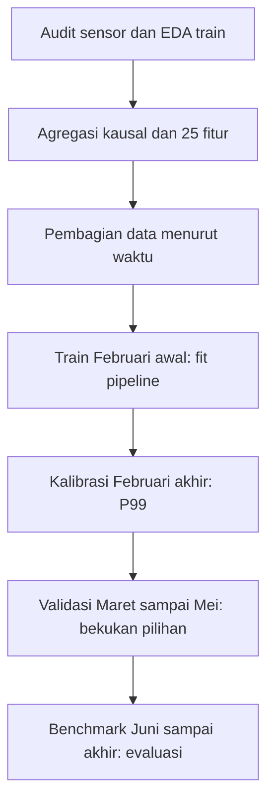
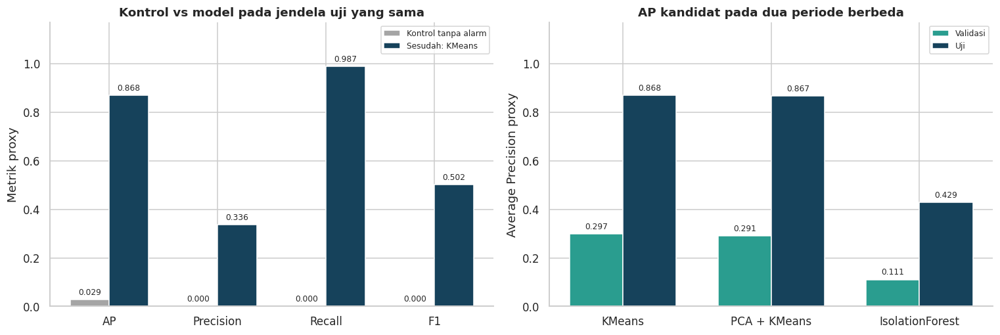
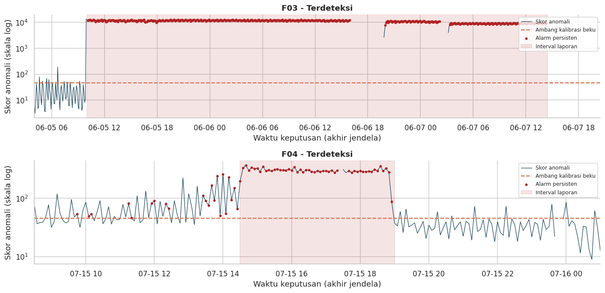
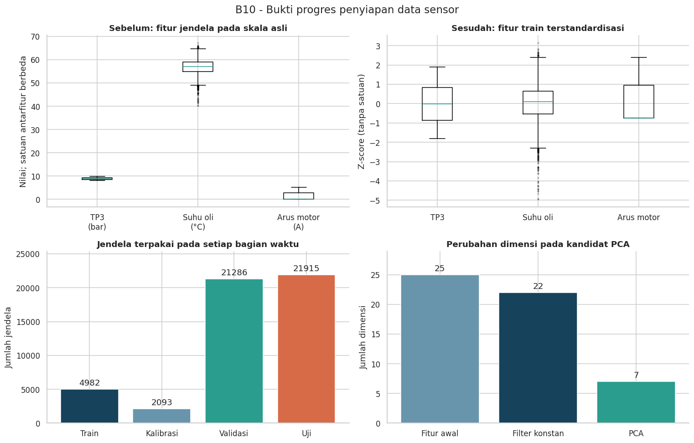

<div align="center">

# DETEKSI ANOMALI PADA DATA SENSOR DAN KONDISI MESIN INDUSTRI MENGGUNAKAN DATASET METROPT-3
# UTS-MACHINE LEARNING
### Kelompok 5

**Havidz Andrian** (NIM: 231111899)<br>
**Fikri Anwar** (NIM: 231112145)<br>
**Purba Tua Siregar** (NIM: 231112463)

<br>

**Link Google Colab - Source Code:**  
[Buka Notebook Google Colab](https://colab.research.google.com/drive/1uxisVuBymipt9o8ZMAF2SnYar2xQGxJy?usp=sharing)

**Link Dataset - MetroPT-3:**  
[Buka Dataset UCI Machine Learning](https://archive.ics.uci.edu/dataset/791/metropt+3+dataset)

**Link File Lengkap UTS:**  
[Buka File Lengkap UTS_B10](https://mikroskilacid-my.sharepoint.com/:f:/g/personal/havidz_andrian_students_mikroskil_ac_id/IgAEw0vYQksgSqMl_R0KOZ1YAS7iKSM1Je-fteaHomgHrOU?e=5VMgCE)

<br>

**Mata Kuliah:** Machine Learning

**Dosen Pengampu:** Dr. Al Hamidy Hazidar, S.Kom., M.I.T.

**Kelas:** IF B-PAGI

**Semester:** 7

**Project ID:** B10

**Topik:** Data Sensor dan Kondisi Mesin Industri

**Fokus:** Deteksi anomali dengan classical machine learning

**Program Studi:** S-1 Teknik Informatika

**Universitas:** Universitas Mikroskil

</div>

<br>

## Shortcut cepat terkait uts:

- [Source Google Colab UTS](https://colab.research.google.com/drive/1uxisVuBymipt9o8ZMAF2SnYar2xQGxJy?usp=sharing)
- [Laporan UTS_Milestone 1](Laporan_UTS_MILESTONE_1_ML_KELOMPOK_5.pdf)
- [Milestone UTS Minggu 2-6](https://github.com/x-kzy/UTS-Machine-Learning/blob/main/MILESTONE%20UTS%20ML%20M2-M6.pdf)
- [Dataset resmi UCI MetroPT-3](https://archive.ics.uci.edu/dataset/791/metropt+3+dataset)
- [Galeri hasil seluruh 14 section](docs/GALLERY.md)
- [Daftar eksperimen dan hasilnya](docs/EXPERIMENTS.md)
- [Peta section, milestone, dan materi kuliah](docs/SECTION_MAP.md)
- [Kesimpulan UTS](#kesimpulan-proyek-uts)

## Masalah dan tujuan

Air Production Unit (APU) menyediakan udara bertekanan untuk sistem pneumatik kereta. Proyek ini mempelajari pola referensi pada tekanan, suhu oli, arus motor, dan sinyal digital untuk memberi skor penyimpangan multivariat serta alarm persisten. CSV tidak mempunyai target kerusakan per baris; empat interval laporan kebocoran udara digunakan sebagai pembanding lemah untuk evaluasi, bukan target fit model.

Keluaran UTS meliputi audit dataset, EDA, fitur jendela lima menit, baseline K-Means, kandidat PCA + K-Means dan Isolation Forest, evaluasi temporal, pemeriksaan inferensi dari sensor mentah, serta rencana pengembangan menuju UAS.

## Dataset dan unit analisis

| Komponen | Hasil pemeriksaan |
| --- | --- |
| Observasi sensor | 1.516.948 |
| Kolom CSV | 17, termasuk timestamp dan ID |
| Sensor | 15: tujuh analog dan delapan digital |
| Periode aktual | 1 Februari 2020 sampai 1 September 2020 |
| Median interval pengamatan | 10 detik |
| Unit model | Jendela lima menit `[start, end)`, keputusan pada akhir jendela |
| Fitur awal | 25: 14 statistik analog, delapan duty digital, tiga fitur rekayasa |
| Fitur nonkonstan | 22; kandidat PCA menggunakan tujuh komponen |

Repository menyediakan [contoh 1.000 baris sensor](data/sample_sensor_1000.csv), [deskripsi resmi](data/Data_Description_Metro.pdf), dan [petunjuk dataset](data/README.md). Contoh 1.000 baris ini digunakan untuk melihat susunan kolom dan bentuk data. Untuk menjalankan ulang seluruh eksperimen berdasarkan urutan waktu saja. 

## Alur eksperimen



| Bagian | Jendela terpakai | Peran |
| --- | ---: | --- |
| Training | 4.982 | Mempelajari imputer, filter, scaler, PCA bila digunakan, dan estimator |
| Kalibrasi | 2.093 | Menentukan kuantil skor P99 |
| Validasi | 21.286 | Membandingkan kandidat, ablation, sensitivitas, dan diagnosis |
| Benchmark | 21.915 | Menguji ulang konfigurasi beku pada periode yang telah dilihat sebelumnya |
| **Total** | **50.276** | Empat bagian eksperimen dengan embargo antarbatas |

Model di-fit tanpa `y_report`. Kandidat dipilih berdasarkan AP proxy validasi; pemilihan ini memanfaatkan pembanding lemah. Alarm memerlukan tiga jendela pelampauan berturut-turut dan direset ketika waktu terputus. Kualitas jendela diperiksa melalui jumlah sampel, jeda internal dan tepi, proporsi missing per sensor, serta penyelesaian jendela.

## Ringkasan hasil final

Seluruh metrik di bawah adalah **proxy terhadap laporan gangguan**.

| Kandidat | AP validasi | AP benchmark | Precision benchmark | Recall benchmark | F1 benchmark | Interval benchmark terdeteksi |
| --- | ---: | ---: | ---: | ---: | ---: | ---: |
| **K-Means, pilihan AP validasi** | **0,2974** | **0,8685** | 0,3362 | 0,9872 | 0,5016 | 2/2 |
| PCA + K-Means | 0,2907 | 0,8667 | 0,3342 | 0,9872 | 0,4994 | 2/2 |
| Isolation Forest | 0,1105 | 0,4293 | 0,4350 | 0,9856 | 0,6036 | 2/2 |
| Kontrol tanpa alarm | 0,0171 | 0,0285 | 0,0000 | 0,0000 | 0,0000 | 0/2 |

K-Means dipilih dari AP validasi, sedangkan Isolation Forest mempunyai F1 lebih tinggi pada konfigurasi alarm yang digunakan. K-Means melewatkan delapan jendela laporan dan menghasilkan 1.218 jendela alarm di luar laporan pada benchmark. Kondisi di luar laporan belum tentu sehat, sehingga angka tersebut belum sama dengan false alarm yang telah diverifikasi teknisi.





## Bukti progres eksperimen

Galeri memuat **18 grafik dari output notebook**, **52 tabel tersimpan**, dan **14 gambar cuplikan tabel**. Setiap halaman menghubungkan gambar, tabel, penjelasan hasil, dan lokasi section sumber.

| Tahap | Bukti dan temuan utama |
| --- | --- |
| [1–3: persiapan dan pemahaman data](docs/stages/02.md) | Versi lingkungan, sumber dan skema, audit sensor, interval laporan, serta pembagian waktu |
| [4: EDA](docs/stages/04.md) | Perbedaan skala; korelasi TP3–Reservoirs 0,999991; nilai ekstrem dipertahankan |
| [5–6: fitur dan baseline](docs/stages/05.md) | 25 fitur, seleksi jendela, pipeline train-only, kalibrasi P99, dan alarm persisten |
| [7: eksperimen K](docs/stages/07.md) | K=2–6; silhouette tertinggi K=2, K=3 tetap untuk pembandingan terkontrol |
| [8: kandidat](docs/stages/08.md) | PCA tujuh komponen mempertahankan 95,692% varians; Isolation Forest 200 pohon |
| [9: validasi dan eksperimen tambahan](docs/stages/09.md) | Lima fold temporal, kurva PR, ablation 22 vs 25 fitur, dan sembilan kombinasi sensitivitas |
| [10–11: benchmark dan diagnosis](docs/stages/10.md) | Confusion matrix, cakupan laporan, episode alarm, error slicing, dan perubahan distribusi |
| [12: inferensi](docs/stages/12.md) | Sensor mentah menjadi fitur dan prediksi; enam pemeriksaan integritas lulus |
| [13–14: ringkasan dan kesimpulan](docs/stages/14.md) | Perubahan skala/dimensi, pencapaian tujuan, trade-off metrik, dan batas penggunaan |



## Menjalankan proyek

**Untuk membaca hasil:** buka notebook atau galeri; gambar sudah tersedia dan tidak memerlukan training ulang.

**Google Colab:** buka tautan notebook, gunakan runtime Python, lalu jalankan sel berurutan dari awal. Dataset diunduh otomatis bila sumber lokal tidak ditemukan.

**Windows CMD, eksperimen lokal:** setelah Python 3.12 terpasang, jalankan dari root repository:

```bat
JALANKAN_EKSPERIMEN.cmd
```

**Perintah Python terpisah:**

```bash
python -m pip install -r requirements.txt
python scripts/download_dataset.py
python scripts/run_project.py
```

Run baru menulis folder `hasil_b10/run_<ID>/`, grafik, 40 tabel lengkap, model, log parameter, konfigurasi, versi lingkungan, skor dan alarm, serta checksum. Folder hasil baru tidak otomatis ditambahkan ke Git. Pilih hasil yang ingin didokumentasikan setelah meninjau perubahan.

## Struktur repository

| Lokasi | Isi |
| --- | --- |
| `notebooks/` | Notebook final dengan kode dan output asli |
| `src/uts_ml.py` | Source Python hasil ekspor seluruh sel notebook, ditambah pemanggilan ekspor hasil |
| `src/b10_runtime.py` | Fungsi fitur dan inferensi mandiri dari Section 5 |
| `src/b10_export.py` | Penyimpanan hasil run; tidak mengubah model atau prediksi |
| `data/` | Tautan, atribusi, deskripsi resmi, dan contoh sensor |
| `docs/` | Galeri per tahap, eksperimen, peta section, kontribusi, dan petunjuk pengujian ulang |
| `results/recorded/` | Tabel dan manifest yang diekstrak dari output final tersimpan |
| `results/reproduced/latest/` | Hasil pengujian ulang beserta tabel lengkap, grafik, model, dan skor |
| `reports/` | Penunjuk laporan PDF final Milestone 1 |
| `config/` | Konfigurasi, versi lingkungan asli, hash sumber, dan provenance |
| `scripts/` | Unduh dataset, menjalankan source, mengekstrak bukti, memeriksa paket, dan push |

## Pengujian Ulang dan Keterbatasan Hasil

Notebook Google Colab dan laporan akhir menjadi acuan hasil proyek. Kode pada Google Colab dan lampiran memiliki 20 sel kode yang sama. Kode versi Python juga sudah dijalankan dari awal sampai akhir. Hasilnya menunjukkan jumlah jendela data yang sama, enam pemeriksaan konsistensi program yang lulus, serta nilai AP, precision, recall, dan F1 yang sesuai hingga empat angka desimal.

Versi library pada eksperimen laporan dan pengujian ulang dicatat dalam `config/original_environment.json` dan `results/reproduced/latest/environment.json`. File `requirements.txt` berisi versi library untuk menjalankan kode pada lingkungan yang sudah diuji. Tabel pada folder `recorded` mengikuti angka yang ditampilkan dalam notebook, sedangkan tabel lengkap dengan angka lebih rinci tersedia pada hasil pengujian ulang. Waktu pelatihan model dapat berbeda ketika kode dijalankan pada lingkungan yang berbeda.

Evaluasi menggunakan empat interval gangguan yang dilaporkan dari satu unit kompresor. Laporan tersebut belum menjelaskan kondisi mesin pada seluruh waktu pengamatan, sehingga waktu di luar laporan belum tentu bebas gangguan. Data benchmark juga sudah pernah diperiksa pada eksperimen sebelumnya, sehingga hasilnya belum menjadi bukti pengujian pada data yang benar-benar belum pernah dilihat.

Model berhasil mendeteksi dua dari dua interval gangguan pada benchmark. Namun, hasil tersebut belum membuktikan bahwa seluruh durasi gangguan berhasil dipantau, penyebab kebocoran dapat ditentukan, atau peringatan dapat diberikan sebelum terjadi kerusakan. Sistem juga masih memerlukan pengujian tambahan sebelum digunakan dalam kegiatan industri.

Pada eksperimen ini, penggunaan PCA dan penambahan tiga fitur rekayasa belum meningkatkan nilai AP dibandingkan pembandingnya. Temuan dan keterbatasan tersebut menjadi dasar penyusunan [rencana pengembangan selanjutnya](docs/PROGRESS_AND_PLAN.md).

## Kesimpulan Proyek UTS

**Tujuan proyek UTS B10 untuk membangun dan membandingkan alur deteksi anomali pada data sensor mesin telah tercapai pada tahap eksperimen.** Pendekatan tanpa supervisi sesuai dengan kondisi dataset MetroPT-3 yang tidak menyediakan label kerusakan pada setiap baris pengamatan.

Capaian utama proyek versi uts ini meliputi:

- **Pengolahan data sensor:** sebanyak 1.516.948 pengamatan dari 15 sensor diolah menjadi 50.276 jendela lima menit yang memenuhi pemeriksaan kualitas.
- **Pembentukan fitur dan pemodelan:** sebanyak 25 fitur awal dibentuk, dengan 22 fitur tersisa setelah penyaringan fitur konstan. K-Means, PCA + K-Means, dan Isolation Forest berhasil dibandingkan menggunakan pembagian data berdasarkan waktu.
- **Pembuatan skor dan alarm:** model menghasilkan skor penyimpangan serta alarm yang membutuhkan tiga jendela pelampauan berturut-turut.
- **Pemeriksaan dan dokumentasi hasil:** enam pemeriksaan integritas berhasil dilalui. Grafik, tabel, hasil eksperimen, notebook, dan laporan tersedia untuk dipelajari serta diuji ulang.

**K-Means dipilih berdasarkan AP validasi tertinggi sebesar 0,2974.** Pada periode benchmark, model ini memperoleh AP 0,8685, precision 0,3362, recall 0,9872, dan F1 0,5016. Alarm muncul pada **dua dari dua interval gangguan benchmark yang teramati**. Isolation Forest memperoleh F1 benchmark lebih tinggi, yaitu 0,6036, sehingga setiap metode tetap mempunyai kelebihan sesuai ukuran penilaian yang digunakan.

Hasil tersebut menunjukkan kemampuan awal untuk mengenali penyimpangan selama interval gangguan. Ketepatan alarm masih perlu diperbaiki karena K-Means melewatkan delapan jendela laporan dan menghasilkan 1.218 jendela alarm di luar laporan. Alarm di luar laporan perlu diperiksa lebih lanjut karena waktu yang tidak tercatat sebagai gangguan belum tentu menunjukkan kondisi mesin yang sehat.

**Hasil versi UTS memberikan dasar eksperimen untuk pemantauan kondisi mesin**, dengan keterbatasan pada kelengkapan laporan gangguan dan cakupan data dari satu kompresor. Kemampuan menentukan penyebab kerusakan, memberikan peringatan sebelum gangguan, dan digunakan dalam kegiatan industri masih memerlukan pembuktian lanjutan. Pengembangan menuju UAS diarahkan pada verifikasi laporan gangguan, pengujian kontribusi fitur, penyesuaian ambang dan beban alarm, serta evaluasi pada periode atau data baru apabila tersedia.

## Rencana untuk UAS
Tahapan rencana untuk UAS adalah melanjutkan dataset MetroPT-3 dan model classical machine learning yang telah diuji pada Milestone 1. Project berikutnya meliputi peninjauan interval gangguan F01-F04, uji kontribusi fitur dan fitur temporal kausal, pengendalian beban alarm, evaluasi kandidat One-Class SVM apabila memungkinkan, analisis drift, dan penguatan reproduksibilitas. Seluruh hasil UTS pada bagian sebelumnya tetap menjadi baseline historis dan bukan hasil UAS.

- [Detail_Rencana UAS](docs/PROGRESS_AND_PLAN.md)
- [Checklist progres UAS](docs/UAS_CHECKLIST.md)
- [Laporan PDF resmi Milestone 1](Laporan_UTS_MILESTONE_1_ML_KELOMPOK_5.pdf)

## Sumber dan lisensi

Dataset: Davari, N., Veloso, B., Ribeiro, R., dan Gama, J. (2021), **MetroPT-3 Dataset**, UCI Machine Learning Repository, DOI [10.24432/C5VW3R](https://doi.org/10.24432/C5VW3R), lisensi **CC BY 4.0**. Sumber data dan aturan penggunaannya dicantumkan di [THIRD_PARTY_NOTICES.md](THIRD_PARTY_NOTICES.md).
