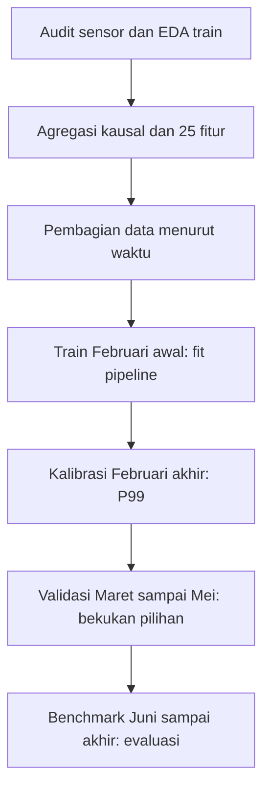

<div align="center">

# DETEKSI ANOMALI PADA DATA SENSOR DAN KONDISI MESIN INDUSTRI

**Menggunakan Dataset MetroPT-3**

### Kelompok 5

**Havidz Andrian** (NIM: 231111899)<br>
**Fikri Anwar** (NIM: 231112145)<br>
**Purba Tua Siregar** (NIM: 231112463)

**UTS Machine Learning · Project ID: B10**

<br>

**Link Google Colab — Source Code:**  
[Buka Notebook Google Colab](https://colab.research.google.com/drive/1uxisVuBymipt9o8ZMAF2SnYar2xQGxJy?usp=sharing)

**Link Dataset — MetroPT-3:**  
[Buka Dataset UCI Machine Learning Repository](https://archive.ics.uci.edu/dataset/791/metropt+3+dataset)

**Link Berkas Lengkap UTS — Source Code dan Laporan:**  
[Buka Berkas Lengkap UTS](GANTI_DENGAN_LINK_BERKAS_LENGKAP_UTS)

<br>

</div>

**Mata Kuliah:** Machine Learning

**Dosen Pengampu:** Dr. Al Hamidy Hazidar, S.Kom., M.I.T.

**Project ID:** B10

**Topik:** Data Sensor dan Kondisi Mesin Industri

**Fokus:** Deteksi anomali dengan classical machine learning

**Program Studi:** S-1 Teknik Informatika, Universitas Mikroskil

## Link utama uts

- [Source Google Colab kelompok](https://colab.research.google.com/drive/1uxisVuBymipt9o8ZMAF2SnYar2xQGxJy?usp=sharing)
- [Notebook final beserta output run](notebooks/UTS_ML_B10_Kelompok5.ipynb)
- [Buka salinan repository di Google Colab](https://colab.research.google.com/github/x-kzy/UTS-Machine-Learning/blob/main/notebooks/UTS_ML_B10_Kelompok5.ipynb)
- [Laporan final Word](reports/Laporan_UTS_ML_B10_Kelompok5.docx)
- [Dataset resmi UCI MetroPT-3](https://archive.ics.uci.edu/dataset/791/metropt+3+dataset)
- [Galeri hasil seluruh 14 section](docs/GALLERY.md)
- [Daftar eksperimen dan interpretasi](docs/EXPERIMENTS.md)
- [Peta section, milestone, dan materi kuliah](docs/SECTION_MAP.md)
- [Cara menjalankan dan memperbarui repository](docs/RUN_AND_UPDATE.md)

## Masalah dan tujuan

Air Production Unit (APU) menyediakan udara bertekanan untuk sistem pneumatik kereta. Proyek ini mempelajari pola referensi pada tekanan, suhu oli, arus motor, dan sinyal digital untuk memberi skor penyimpangan multivariat serta alarm persisten. CSV tidak mempunyai target kerusakan per baris; empat interval laporan kebocoran udara digunakan sebagai pembanding lemah untuk evaluasi, bukan target fit model.

Keluaran UTS meliputi audit dataset, EDA, fitur jendela lima menit, baseline K-Means, kandidat PCA + K-Means dan Isolation Forest, evaluasi temporal, pemeriksaan inferensi dari sensor mentah, serta rencana pengembangan menuju UAS.

## Dataset dan unit analisis

| Komponen | Hasil pemeriksaan |
| --- | --- |
| Observasi sensor | 1.516.948 |
| Kolom CSV | 17, termasuk timestamp dan ID |
| Sensor | 15: tujuh analog dan delapan digital |
| Periode aktual | 1 Februari 2020 sampai 1 September 2020 |
| Median interval pengamatan | 10 detik |
| Unit model | Jendela lima menit `[start, end)`, keputusan pada akhir jendela |
| Fitur awal | 25: 14 statistik analog, delapan duty digital, tiga fitur rekayasa |
| Fitur nonkonstan | 22; kandidat PCA menggunakan tujuh komponen |

Dataset lengkap tersedia melalui sumber UCI dan [skrip unduh dengan pemeriksaan checksum](scripts/download_dataset.py). Repository menyediakan [contoh 1.000 baris sensor](data/sample_sensor_1000.csv), [deskripsi resmi](data/Data_Description_Metro.pdf), dan [petunjuk dataset](data/README.md). Contoh 1.000 baris hanya untuk melihat skema dan tidak cukup untuk mereproduksi eksperimen temporal.

## Alur eksperimen



| Bagian | Jendela terpakai | Peran |
| --- | ---: | --- |
| Training | 4.982 | Mempelajari imputer, filter, scaler, PCA bila digunakan, dan estimator |
| Kalibrasi | 2.093 | Menentukan kuantil skor P99 |
| Validasi | 21.286 | Membandingkan kandidat, ablation, sensitivitas, dan diagnosis |
| Benchmark | 21.915 | Menguji ulang konfigurasi beku pada periode yang telah dilihat sebelumnya |
| **Total** | **50.276** | Empat bagian eksperimen dengan embargo antarbatas |

Model di-fit tanpa `y_report`. Kandidat dipilih berdasarkan AP proxy validasi; pemilihan ini memanfaatkan pembanding lemah. Alarm memerlukan tiga jendela pelampauan berturut-turut dan direset ketika waktu terputus. Kualitas jendela diperiksa melalui jumlah sampel, jeda internal dan tepi, proporsi missing per sensor, serta penyelesaian jendela.

## Ringkasan hasil final

Seluruh metrik di bawah adalah **proxy terhadap laporan gangguan**.

| Kandidat | AP validasi | AP benchmark | Precision benchmark | Recall benchmark | F1 benchmark | Interval benchmark terdeteksi |
| --- | ---: | ---: | ---: | ---: | ---: | ---: |
| **K-Means, pilihan AP validasi** | **0,2974** | **0,8685** | 0,3362 | 0,9872 | 0,5016 | 2/2 |
| PCA + K-Means | 0,2907 | 0,8667 | 0,3342 | 0,9872 | 0,4994 | 2/2 |
| Isolation Forest | 0,1105 | 0,4293 | 0,4350 | 0,9856 | 0,6036 | 2/2 |
| Kontrol tanpa alarm | 0,0171 | 0,0285 | 0,0000 | 0,0000 | 0,0000 | 0/2 |

K-Means dipilih dari AP validasi, sedangkan Isolation Forest mempunyai F1 lebih tinggi pada konfigurasi alarm yang digunakan. K-Means melewatkan delapan jendela laporan dan menghasilkan 1.218 jendela alarm di luar laporan pada benchmark. Kondisi di luar laporan belum tentu sehat, sehingga angka tersebut belum sama dengan false alarm yang telah diverifikasi teknisi.


## Bukti progres eksperimen

Galeri memuat **18 grafik dari output notebook**, **52 tabel tersimpan**, dan **14 gambar cuplikan tabel**. Setiap halaman menghubungkan gambar, tabel, penjelasan hasil, dan lokasi section sumber.

| Tahap | Bukti dan temuan utama |
| --- | --- |
| [1–3: persiapan dan pemahaman data](docs/stages/02.md) | Versi lingkungan, sumber dan skema, audit sensor, interval laporan, serta pembagian waktu |
| [4: EDA](docs/stages/04.md) | Perbedaan skala; korelasi TP3–Reservoirs 0,999991; nilai ekstrem dipertahankan |
| [5–6: fitur dan baseline](docs/stages/05.md) | 25 fitur, seleksi jendela, pipeline train-only, kalibrasi P99, dan alarm persisten |
| [7: eksperimen K](docs/stages/07.md) | K=2–6; silhouette tertinggi K=2, K=3 tetap untuk pembandingan terkontrol |
| [8: kandidat](docs/stages/08.md) | PCA tujuh komponen mempertahankan 95,692% varians; Isolation Forest 200 pohon |
| [9: validasi dan eksperimen tambahan](docs/stages/09.md) | Lima fold temporal, kurva PR, ablation 22 vs 25 fitur, dan sembilan kombinasi sensitivitas |
| [10–11: benchmark dan diagnosis](docs/stages/10.md) | Confusion matrix, cakupan laporan, episode alarm, error slicing, dan perubahan distribusi |
| [12: inferensi](docs/stages/12.md) | Sensor mentah menjadi fitur dan prediksi; enam pemeriksaan integritas lulus |
| [13–14: ringkasan dan kesimpulan](docs/stages/14.md) | Perubahan skala/dimensi, pencapaian tujuan, trade-off metrik, dan batas penggunaan |


## Menjalankan proyek

**Untuk membaca hasil:** buka notebook atau galeri; gambar sudah tersedia dan tidak memerlukan training ulang.

**Google Colab:** buka tautan notebook, gunakan runtime Python, lalu jalankan sel berurutan dari awal. Dataset diunduh otomatis bila sumber lokal tidak ditemukan.

**Windows CMD, eksperimen lokal:** setelah Python 3.12 terpasang, jalankan dari root repository:

```bat
JALANKAN_EKSPERIMEN.cmd
```

**Perintah Python terpisah:**

```bash
python -m pip install -r requirements.txt
python scripts/download_dataset.py
python scripts/run_project.py
```

Run baru menulis folder `hasil_b10/run_<ID>/`, grafik, 40 tabel lengkap, model, log parameter, konfigurasi, versi lingkungan, skor dan alarm, serta checksum. Folder hasil baru tidak otomatis ditambahkan ke Git. Pilih hasil yang ingin didokumentasikan setelah meninjau perubahan.

## Struktur repository

| Lokasi | Isi |
| --- | --- |
| `notebooks/` | Notebook final dengan kode dan output asli |
| `src/uts_ml.py` | Source Python hasil ekspor seluruh sel notebook, ditambah pemanggilan ekspor hasil |
| `src/b10_runtime.py` | Fungsi fitur dan inferensi mandiri dari Section 5 |
| `src/b10_export.py` | Penyimpanan hasil run; tidak mengubah model atau prediksi |
| `data/` | Tautan, atribusi, deskripsi resmi, dan contoh sensor |
| `docs/` | Galeri per tahap, eksperimen, peta section, kontribusi, dan petunjuk reproduksi |
| `results/recorded/` | Tabel dan manifest yang diekstrak dari output final tersimpan |
| `results/reproduced/latest/` | Satu run reproduksi yang telah diuji beserta tabel lengkap, grafik, model, dan skor |
| `reports/` | Laporan Word final |
| `config/` | Konfigurasi, versi lingkungan asli, hash sumber, dan provenance |
| `scripts/` | Unduh dataset, menjalankan source, mengekstrak bukti, memeriksa paket, dan push |

## Reproduksi dan batas interpretasi

Notebook serta laporan final dipertahankan sebagai sumber hasil yang dilaporkan. Source Colab dan lampiran mempunyai 20 sel kode komputasi yang identik. Source Python hasil ekspor telah dijalankan dari awal sampai akhir; pembagian jendela, enam pemeriksaan integritas, dan metrik AP/precision/recall/F1 pada empat angka desimal sesuai dengan output final.

Lingkungan asli laporan dan lingkungan uji paket dicatat terpisah di `config/original_environment.json` dan `results/reproduced/latest/environment.json`. `requirements.txt` mengunci lingkungan paket yang diuji. Tabel `recorded` mengikuti presisi serta cakupan tampilan notebook; tabel lengkap berpresisi penuh tersedia pada run reproduksi. Waktu fit dapat berbeda antarlingkungan.

Empat interval laporan berasal dari satu kompresor dan merupakan pembanding lemah. Benchmark telah diperiksa pada iterasi sebelumnya sehingga tidak disebut hold-out baru. Deteksi 2/2 interval tidak membuktikan seluruh durasi termonitor, diagnosis penyebab kebocoran, prediksi sebelum kegagalan, atau kesiapan industri. PCA dan tiga fitur rekayasa belum meningkatkan AP pada eksperimen yang dilaporkan. [Rencana lanjutan](docs/PROGRESS_AND_PLAN.md) mempertahankan batas tersebut.

## Pembaruan repository

Riwayat commit mencatat unggahan dan perubahan aktual. Catatan eksperimen menjelaskan konfigurasi dan hasil dalam notebook; pembaruan selanjutnya menyertakan run ID, alasan perubahan, tabel pembanding, dan bukti gambar yang baru.

Untuk mengunggah paket awal ke repository yang sudah ada, jalankan `PUSH_KE_GITHUB.cmd`. Script mengambil branch `main` terbaru, menyalin file paket, membuat commit, lalu melakukan push tanpa force. Login GitHub diperlukan bila Git di komputer belum terautentikasi.

## Sumber dan lisensi

Dataset: Davari, N., Veloso, B., Ribeiro, R., dan Gama, J. (2021), **MetroPT-3 Dataset**, UCI Machine Learning Repository, DOI [10.24432/C5VW3R](https://doi.org/10.24432/C5VW3R), lisensi **CC BY 4.0**. Atribusi dan ketentuan data dipertahankan di [THIRD_PARTY_NOTICES.md](THIRD_PARTY_NOTICES.md). Lisensi kode mengikuti [LICENSE](LICENSE) yang sudah ada pada repository.
