# Galeri hasil eksperimen per tahap

Grafik PNG berikut diekstrak dari output notebook final. Gambar tabel dirender dari nilai yang tersimpan pada output tersebut. Ini merupakan urutan eksperimen dalam notebook, dengan provenance pada setiap section.

[Kembali ke README](../README.md) · [Ringkasan eksperimen](EXPERIMENTS.md)

## 1. Settings Environment

[Lihat penjelasan dan seluruh output tahap ini](stages/01.md)

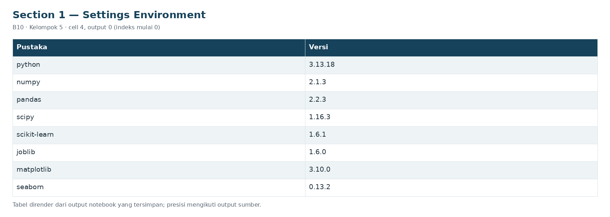

## 2. Akuisisi dataset, skema, dan kamus sensor

[Lihat penjelasan dan seluruh output tahap ini](stages/02.md)

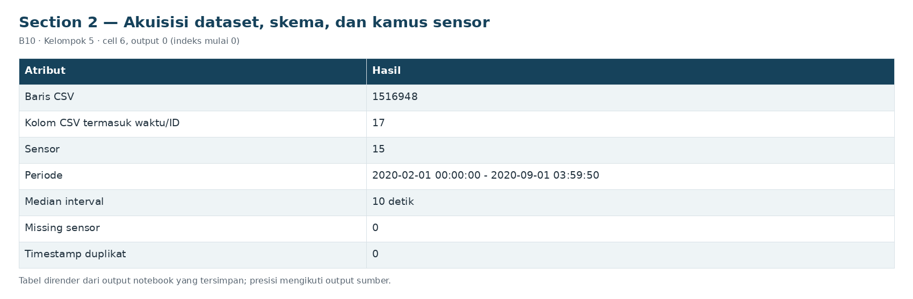

## 3. Rancangan waktu, interval gangguan, dan protokol evaluasi

[Lihat penjelasan dan seluruh output tahap ini](stages/03.md)

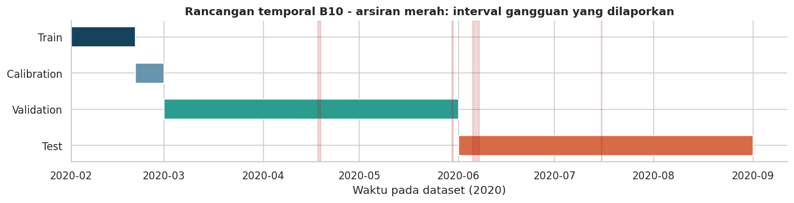

## 4. EDA train, temuan, dan implikasi preprocessing

[Lihat penjelasan dan seluruh output tahap ini](stages/04.md)

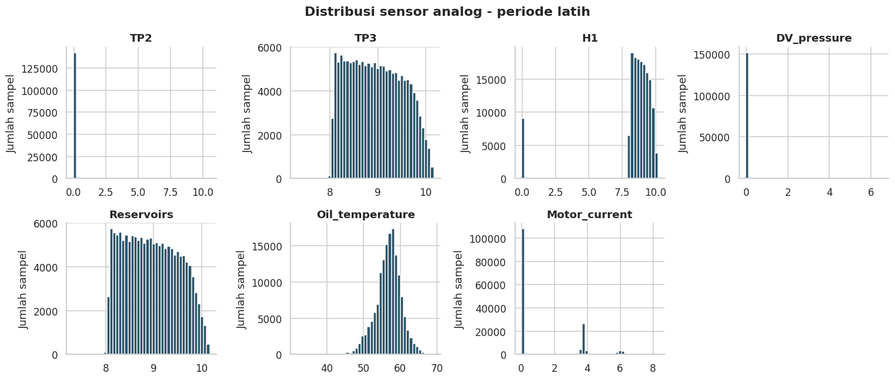

## 5. Agregasi kausal, rekayasa fitur, dan kualitas jendela

[Lihat penjelasan dan seluruh output tahap ini](stages/05.md)

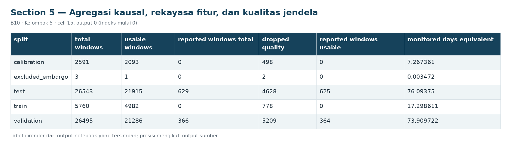

## 6. Pipeline preprocessing dan baseline K-Means

[Lihat penjelasan dan seluruh output tahap ini](stages/06.md)

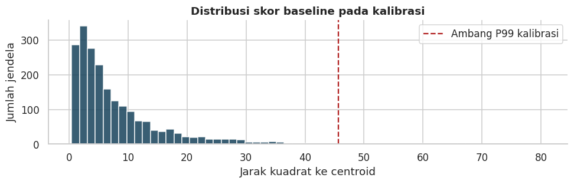

## 7. Eksperimen K, evaluasi dan interpretasi cluster

[Lihat penjelasan dan seluruh output tahap ini](stages/07.md)

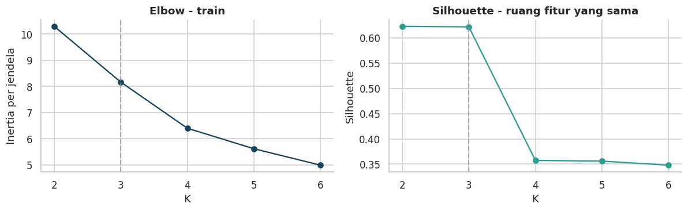

## 8. Kandidat PCA + K-Means dan ensemble Isolation Forest

[Lihat penjelasan dan seluruh output tahap ini](stages/08.md)

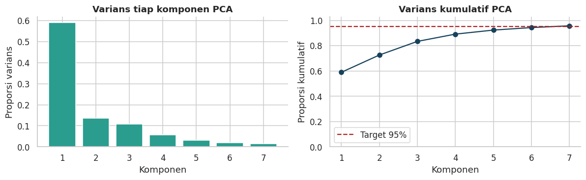

## 9. Validasi temporal, ablation, sensitivitas, dan pemilihan kandidat

[Lihat penjelasan dan seluruh output tahap ini](stages/09.md)

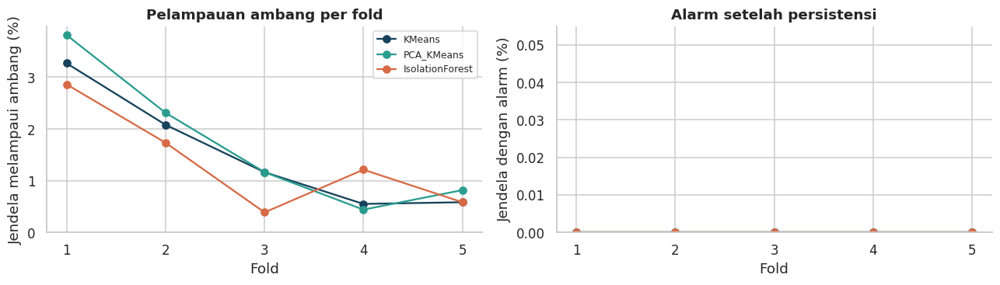

## 10. Pengujian ulang benchmark temporal dengan konfigurasi beku

[Lihat penjelasan dan seluruh output tahap ini](stages/10.md)

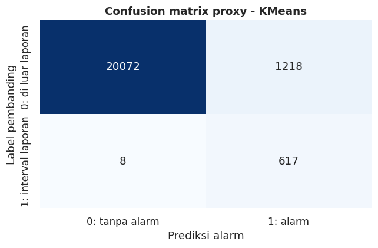

## 11. Diagnosis validasi, pergeseran distribusi, dan error analysis

[Lihat penjelasan dan seluruh output tahap ini](stages/11.md)

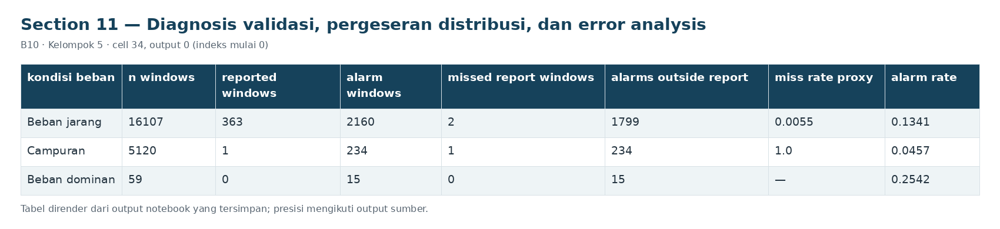

## 12. Inferensi mandiri dari sensor mentah dan pemeriksaan integritas

[Lihat penjelasan dan seluruh output tahap ini](stages/12.md)

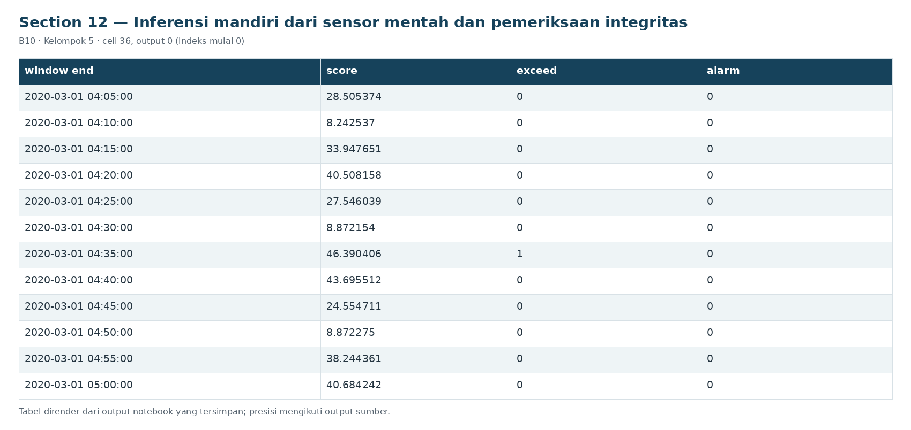

## 13. Ringkasan visual penyiapan data

[Lihat penjelasan dan seluruh output tahap ini](stages/13.md)

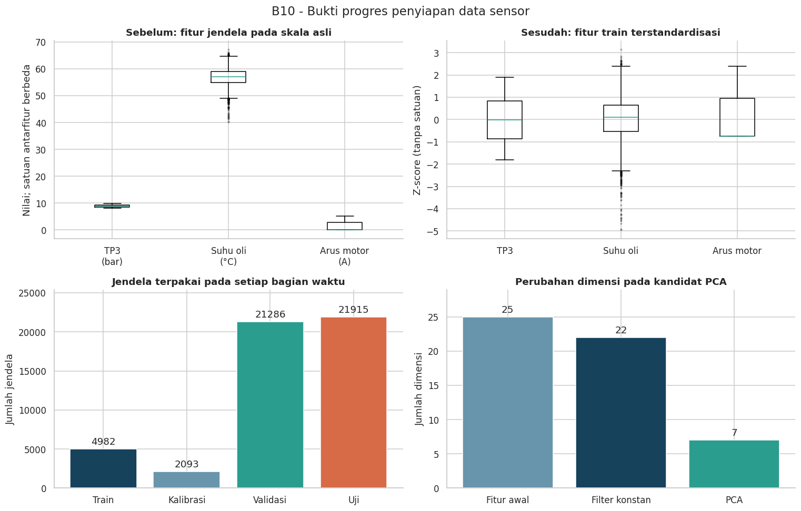

## 14. Hasil akhir run, dan kesimpulan awal

[Lihat penjelasan dan seluruh output tahap ini](stages/14.md)

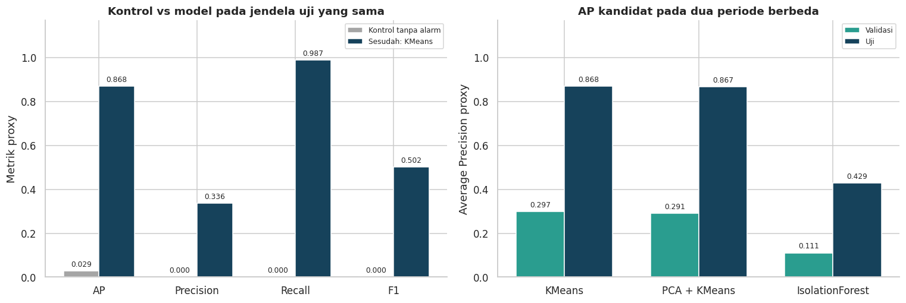

