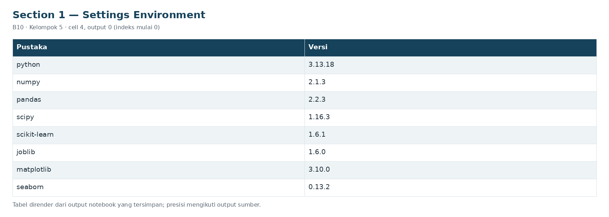

# Section 1 Settings Environment

**SECTION 1: Settings Environment**

Seluruh parameter utama dicatat sebelum fit dan sebelum membandingkan kandidat. P99 adalah asumsi referensi, bukan jaminan false positive rate operasional.

[Galeri seluruh tahap](../GALLERY.md) · [Notebook sumber](../../notebooks/UTS_ML_B10_Kelompok5.ipynb)

[Tabel CSV dari output tersimpan](../../results/recorded/tables/s01_c004_o00.csv)

| Pustaka | Versi |
| --- | --- |
| python | 3.13.18 |
| numpy | 2.1.3 |
| pandas | 2.2.3 |
| scipy | 1.16.3 |
| scikit-learn | 1.6.1 |
| joblib | 1.6.0 |
| matplotlib | 3.10.0 |
| seaborn | 0.13.2 |

**Run:** `20261029T192818_729703Z`; Python hash seed startup: `tidak ditetapkan saat startup`. Pemilihan utama: AP proxy validasi, tie-break event recall, F1, nama model. Kualitas pemeringkatan dan kualitas alarm dinilai terpisah. Accuracy hanya diagnostik karena pembanding sangat tidak seimbang dan tidak lengkap.
