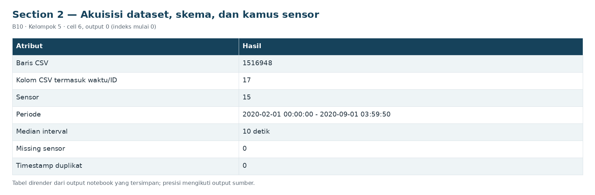

# Section 2 Akuisisi dataset, skema, dan kamus sensor

**SECTION 2: Akuisisi dataset, skema, dan kamus sensor**

Angka ukuran dan resolusi berasal dari CSV yang dibaca; metadata sumber yang berbeda disimpan sebagai perbedaan dokumentasi.

[Galeri seluruh tahap](../GALLERY.md) · [Notebook sumber](../../notebooks/UTS_ML_B10_Kelompok5.ipynb)

[Tabel CSV dari output tersimpan](../../results/recorded/tables/s02_c006_o00.csv)

| Atribut | Hasil |
| --- | --- |
| Baris CSV | 1516948 |
| Kolom CSV termasuk waktu/ID | 17 |
| Sensor | 15 |
| Periode | 2020-02-01 00:00:00 - 2020-09-01 03:59:50 |
| Median interval | 10 detik |
| Missing sensor | 0 |
| Timestamp duplikat | 0 |

[Tabel CSV dari output tersimpan](../../results/recorded/tables/s02_c006_o01.csv)

| timestamp | TP2 | TP3 | H1 | DV_pressure | Reservoirs | Oil_temperature | Motor_current | COMP |
| --- | --- | --- | --- | --- | --- | --- | --- | --- |
| 2020-02-01 00:00:00 | -0.012 | 9.358 | 9.34 | -0.024 | 9.358 | 53.6 | 0.04 | 1.0 |
| 2020-02-01 00:00:10 | -0.014 | 9.348 | 9.332 | -0.022 | 9.348 | 53.675 | 0.04 | 1.0 |
| 2020-02-01 00:00:19 | -0.012 | 9.338 | 9.322 | -0.022 | 9.338 | 53.6 | 0.0425 | 1.0 |

Cuplikan 3 dari 3 baris dan 9 dari 16 kolom tersimpan.

[Tabel CSV dari output tersimpan](../../results/recorded/tables/s02_c006_o02.csv)

| Interval (detik) | Jumlah |
| --- | --- |
| 10.0 | 1337521 |
| 9.0 | 128277 |
| 12.0 | 38321 |
| 13.0 | 7988 |
| 11.0 | 4471 |

[Tabel CSV dari output tersimpan](../../results/recorded/tables/s02_c006_o03.csv)

| kolom | dtype | jenis | missing_setelah_audit | n_unique |
| --- | --- | --- | --- | --- |
| TP2 | float64 | analog | 0 | 5257 |
| TP3 | float64 | analog | 0 | 3683 |
| H1 | float64 | analog | 0 | 2665 |
| DV_pressure | float64 | analog | 0 | 2257 |
| Reservoirs | float64 | analog | 0 | 3682 |
| Oil_temperature | float64 | analog | 0 | 2462 |
| Motor_current | float64 | analog | 0 | 1809 |
| COMP | float64 | digital | 0 | 2 |
| DV_eletric | float64 | digital | 0 | 2 |
| Towers | float64 | digital | 0 | 2 |
| MPG | float64 | digital | 0 | 2 |
| LPS | float64 | digital | 0 | 2 |
| Pressure_switch | float64 | digital | 0 | 2 |
| Oil_level | float64 | digital | 0 | 2 |

Cuplikan 14 dari 15 baris dan 5 dari 5 kolom tersimpan.

[Tabel CSV dari output tersimpan](../../results/recorded/tables/s02_c006_o04.csv)

| Aspek | Metadata sumber | Bukti CSV/keputusan | Implikasi |
| --- | --- | --- | --- |
| Jumlah observasi | 15.169.480 pada PDF deskripsi; 1.516.948 pada ... | 1,516,948 baris setelah audit | Gunakan ukuran CSV aktual; tidak mengklaim mem... |
| Resolusi | PDF/logging asal 1 Hz; UCI atribut menyebut 0,... | 10 detik; train 10 detik | Kelengkapan jendela memakai cadence train; tid... |
| Rentang waktu | Februari-Agustus 2020 pada narasi sumber | 2020-02-01 00:00:00 sampai 2020-09-01 03:59:50 | Laporkan rentang yang benar-benar terbaca, ter... |
| ID laporan | Nomor #1 ditulis dua kali; catatan maintenance... | F01-F04 adalah ID internal | Pertahankan waktu kejadian, jangan menebak kor... |

**Hasil audit:** 1,516,948 baris mentah, 17 kolom CSV,  15 sensor; 0 timestamp invalid, 0 duplikat timestamp. Terdapat 57,475 vektor sensor berulang; vektor ini **tidak dihapus**, karena kondisi operasi yang tetap pada timestamp berbeda adalah observasi yang sah. ID baris sumber dikecualikan dari model. Audit kualitas global tidak digunakan untuk mempelajari scaler, imputer, PCA, atau ambang.

[Tabel CSV dari output tersimpan](../../results/recorded/tables/s02_c007_o00.csv)

| Variabel | Jenis | Satuan | Makna |
| --- | --- | --- | --- |
| TP2 | Analog | bar | Tekanan kompresor |
| TP3 | Analog | bar | Tekanan panel pneumatik |
| H1 | Analog | bar | Sinyal tekanan pada komponen separator |
| DV_pressure | Analog | bar | Tekanan terkait pembuangan pada pengering udara |
| Reservoirs | Analog | bar | Tekanan reservoir; dibandingkan dengan TP3 |
| Oil_temperature | Analog | °C | Suhu oli kompresor |
| Motor_current | Analog | A | Arus motor; dokumentasi menyebut sekitar 0/4/7... |
| COMP | Digital | 0/1 | Sinyal katup intake |
| DV_eletric | Digital | 0/1 | Sinyal katup outlet; ejaan asli CSV |
| Towers | Digital | 0/1 | Status tower pengering |
| MPG | Digital | 0/1 | Sinyal pengaktifan kompresor |
| LPS | Digital | 0/1 | Sinyal tekanan rendah |
| Pressure_switch | Digital | 0/1 | Sinyal pressure switch |
| Oil_level | Digital | 0/1 | Sinyal level oli |

Cuplikan 14 dari 15 baris dan 4 dari 4 kolom tersimpan.
