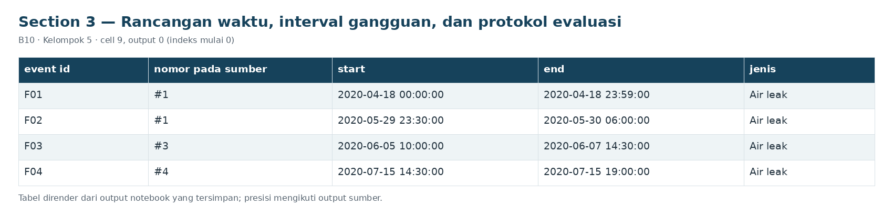
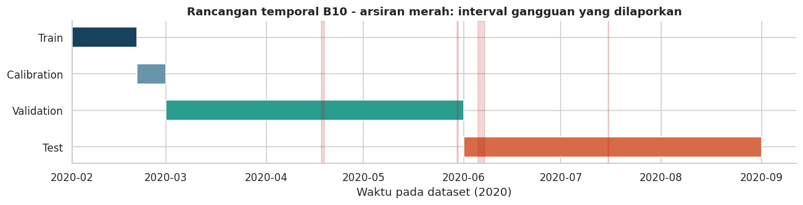

# Section 3 Rancangan waktu, interval gangguan, dan protokol evaluasi

**SECTION 3: Rancangan waktu, interval gangguan, dan protokol evaluasi**

Fit Februari awal, kalibrasi Februari akhir, validasi Maret-Mei, benchmark Juni-akhir. Embargo satu jendela dipakai secara konservatif; tidak menghilangkan seluruh autokorelasi.

[Galeri seluruh tahap](../GALLERY.md) · [Notebook sumber](../../notebooks/UTS_ML_B10_Kelompok5.ipynb)

[Tabel CSV dari output tersimpan](../../results/recorded/tables/s03_c009_o00.csv)

| event_id | nomor_pada_sumber | start | end | jenis |
| --- | --- | --- | --- | --- |
| F01 | #1 | 2020-04-18 00:00:00 | 2020-04-18 23:59:00 | Air leak |
| F02 | #1 | 2020-05-29 23:30:00 | 2020-05-30 06:00:00 | Air leak |
| F03 | #3 | 2020-06-05 10:00:00 | 2020-06-07 14:30:00 | Air leak |
| F04 | #4 | 2020-07-15 14:30:00 | 2020-07-15 19:00:00 | Air leak |

**Ketentuan label:** batas interval mengikuti waktu pada sumber dan bersifat inklusif pada timestamp sampel. Satu jendela diberi label laporan 1 bila mengandung sedikitnya satu sampel dalam interval tersebut. ID F01-F04 adalah ID internal: nomor #1 yang terulang pada sumber tetap dicatat. Catatan maintenance yang bertanggal tidak konsisten tidak dipakai untuk mengubah interval. Label 0 berarti di luar laporan, bukan bukti sehat.

[Tabel CSV dari output tersimpan](../../results/recorded/tables/s03_c009_o02.csv)

| Bagian | Awal jendela | Batas akhir | Peran |
| --- | --- | --- | --- |
| Train | 2020-02-01 00:00:00 | 2020-02-21 00:00:00 | Fit imputer, seleksi konstan, scaler, dan model |
| Calibration | 2020-02-21 00:05:00 | 2020-03-01 00:00:00 | Ambang P99; tidak melatih ulang model |
| Validation | 2020-03-01 00:05:00 | 2020-06-01 00:00:00 | Perbandingan kandidat dan analisis kesalahan |
| Test | 2020-06-01 00:05:00 | 2020-09-01 04:00:00 | Pengujian ulang benchmark, bukan hold-out baru |

[Tabel CSV dari output tersimpan](../../results/recorded/tables/s03_c009_o05.csv)

| Tahap | Data | Peran |
| --- | --- | --- |
| Fit | Train Februari awal | Imputer, filter konstan, scaler, PCA bila ada,... |
| Kalibrasi | Februari akhir | Kuantil skor; tanpa label gangguan dan tanpa r... |
| Pemilihan | Validasi Maret-Mei | AP proxy utama; event recall dan F1 sebagai ti... |
| Sensitivitas | Validasi saja | Eksperimen diagnostik, tidak mengganti konfigu... |
| Benchmark | Juni-akhir; telah terlihat pada versi lama | Semua kandidat beku dievaluasi; bukan sumber t... |
