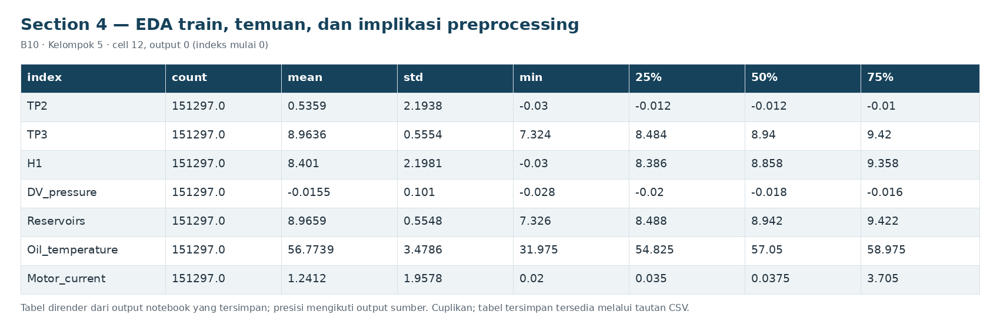
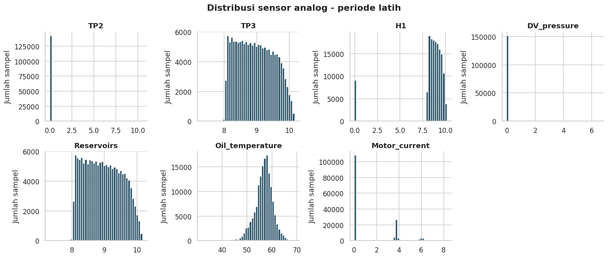
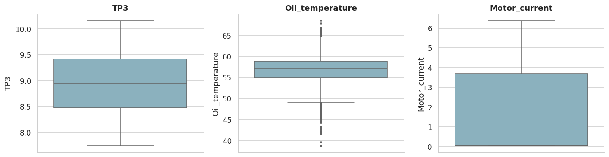
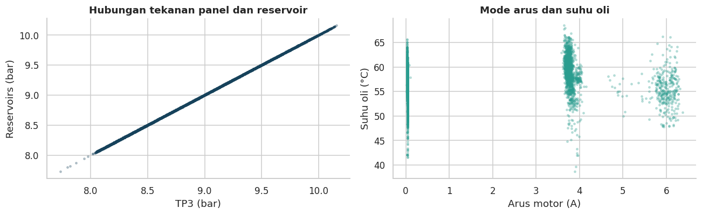
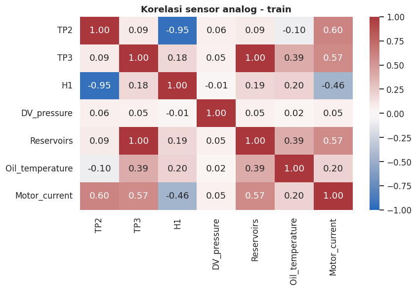
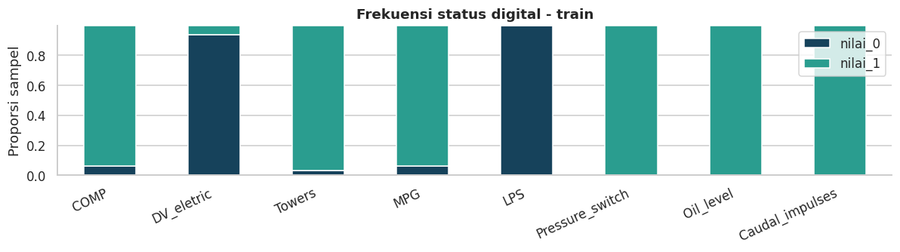

# Section 4 EDA train, temuan, dan implikasi preprocessing

**SECTION 4: EDA train, temuan, dan implikasi preprocessing**

Grafik distribusi hanya memakai data training. Nilai ekstrem dipertahankan agar tidak menghapus sinyal anomali.

[Galeri seluruh tahap](../GALLERY.md) · [Notebook sumber](../../notebooks/UTS_ML_B10_Kelompok5.ipynb)

[Tabel CSV dari output tersimpan](../../results/recorded/tables/s04_c012_o00.csv)

| index | count | mean | std | min | 25% | 50% | 75% | max |
| --- | --- | --- | --- | --- | --- | --- | --- | --- |
| TP2 | 151297.0 | 0.5359 | 2.1938 | -0.03 | -0.012 | -0.012 | -0.01 | 10.544 |
| TP3 | 151297.0 | 8.9636 | 0.5554 | 7.324 | 8.484 | 8.94 | 9.42 | 10.164 |
| H1 | 151297.0 | 8.401 | 2.1981 | -0.03 | 8.386 | 8.858 | 9.358 | 10.158 |
| DV_pressure | 151297.0 | -0.0155 | 0.101 | -0.028 | -0.02 | -0.018 | -0.016 | 6.53 |
| Reservoirs | 151297.0 | 8.9659 | 0.5548 | 7.326 | 8.488 | 8.942 | 9.422 | 10.168 |
| Oil_temperature | 151297.0 | 56.7739 | 3.4786 | 31.975 | 54.825 | 57.05 | 58.975 | 69.15 |
| Motor_current | 151297.0 | 1.2412 | 1.9578 | 0.02 | 0.035 | 0.0375 | 3.705 | 8.2925 |

Cuplikan 7 dari 7 baris dan 9 dari 10 kolom tersimpan.

[Tabel CSV dari output tersimpan](../../results/recorded/tables/s04_c012_o01.csv)

| index | nilai_0 | nilai_1 |
| --- | --- | --- |
| COMP | 9154 | 142143 |
| DV_eletric | 142141 | 9156 |
| Towers | 4567 | 146730 |
| MPG | 9154 | 142143 |
| LPS | 151296 | 1 |
| Pressure_switch | 115 | 151182 |
| Oil_level | 0 | 151297 |
| Caudal_impulses | 0 | 151297 |

**Interpretasi grafik:** histogram dan boxplot memuat 151,297 sampel train; rata-rata suhu oli 56.77 °C. Scatter dan heatmap menunjukkan korelasi TP3-Reservoirs 0.999991, sehingga selisih tekanan dan PCA relevan untuk diuji. Multimodalitas arus dapat berkaitan dengan mode operasi, bukan otomatis gangguan. Bar digital memperlihatkan sinyal yang konstan atau jarang aktif; perubahan status yang belum muncul di train perlu dicatat sebagai keterbatasan.

[Tabel CSV dari output tersimpan](../../results/recorded/tables/s04_c013_o00.csv)

| index | IQR | indikasi_IQR | proporsi_indikasi |
| --- | --- | --- | --- |
| TP2 | 0.002 | 18337 | 0.1212 |
| TP3 | 0.936 | 0 | 0.0 |
| H1 | 0.972 | 9179 | 0.0607 |
| DV_pressure | 0.004 | 664 | 0.0044 |
| Reservoirs | 0.934 | 0 | 0.0 |
| Oil_temperature | 4.15 | 3444 | 0.0228 |
| Motor_current | 3.67 | 0 | 0.0 |

[Tabel CSV dari output tersimpan](../../results/recorded/tables/s04_c013_o01.csv)

| Temuan | Bukti | Implikasi / rencana |
| --- | --- | --- |
| Missing/duplikasi | Missing sensor=0; timestamp ganda=0 | Imputer median tetap berada di pipeline; tidak... |
| Skala dan tipe sensor | 7 analog dengan satuan berbeda; 8 sinyal biner | Statistik analog dan duty digital; StandardSca... |
| Korelasi tekanan | Korelasi TP3-Reservoirs pada train=0.999991 | Bentuk fitur selisih tekanan; uji PCA sebagai ... |
| Nilai ekstrem | IQR menandai 31,624 nilai analog pada train | Tidak menghapus/capping otomatis: nilai ekstre... |
| Jeda waktu | Median interval=10 detik; jeda maksimum file=1... | Agregasi lima menit, audit kelengkapan, dan re... |

[Tabel CSV dari output tersimpan](../../results/recorded/tables/s04_c013_o02.csv)

| Temuan | Bukti | Interpretasi | Implikasi / rencana |
| --- | --- | --- | --- |
| Missing/duplikasi | Missing sensor=0; timestamp ganda=0 | Tidak ada nilai kosong tidak berarti tidak ada... | Imputer median tetap berada di pipeline; tidak... |
| Skala dan tipe sensor | 7 analog dengan satuan berbeda; 8 sinyal biner | Satuan fisik berbeda dapat mendominasi jarak b... | Statistik analog dan duty digital; StandardSca... |
| Korelasi tekanan | Korelasi TP3-Reservoirs pada train=0.999991 | Dua tekanan merekam informasi yang sangat seru... | Bentuk fitur selisih tekanan; uji PCA sebagai ... |
| Nilai ekstrem | IQR menandai 31,624 nilai analog pada train | Batas IQR mengasumsikan sebaran sederhana; mod... | Tidak menghapus/capping otomatis: nilai ekstre... |
| Jeda waktu | Median interval=10 detik; jeda maksimum file=1... | Data adalah time series tidak sepenuhnya terat... | Agregasi lima menit, audit kelengkapan, dan re... |

[Tabel CSV dari output tersimpan](../../results/recorded/tables/s04_c013_o03.csv)

| Masalah | Penanganan | Alasan |
| --- | --- | --- |
| Timestamp rusak/duplikat | Hapus timestamp invalid, sort, keep-last untuk... | Menghindari urutan waktu ambigu |
| Vektor sensor sama pada waktu berbeda | Pertahankan | Operasi diam/stabil tetap observasi yang valid |
| Digital di luar 0/1 dan infinity | Ubah NaN, laporkan jumlah; jangan ubah polarit... | Kualitas sensor tidak disamakan dengan kondisi... |
| Jeda dan jendela parsial | Keluarkan jendela gagal aturan kualitas, lapor... | Tidak menginterpolasi gangguan perekaman |
| NaN tersisa dalam fitur | SimpleImputer median, fit train/fold-train saja | Tanpa statistik masa depan |
| Konstan/skala/korelasi | VarianceThreshold -> StandardScaler -> PCA unt... | Semua dipelajari di dalam Pipeline |
| Outlier analog | Pertahankan dan audit, tanpa capping/IQR remov... | Anomali dapat berada pada ekor distribusi |
