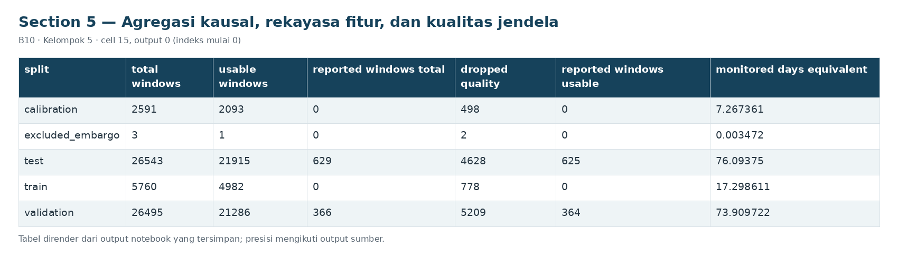

# Section 5 Agregasi kausal, rekayasa fitur, dan kualitas jendela

**SECTION 5: Agregasi kausal, rekayasa fitur, dan kualitas jendela**

Mean/std tujuh analog, duty delapan digital, serta tiga fitur rekayasa. Audit memeriksa setiap jendela, termasuk tepi dan missing per sensor.

[Galeri seluruh tahap](../GALLERY.md) · [Notebook sumber](../../notebooks/UTS_ML_B10_Kelompok5.ipynb)

[Tabel CSV dari output tersimpan](../../results/recorded/tables/s05_c015_o00.csv)

| split | total_windows | usable_windows | reported_windows_total | dropped_quality | reported_windows_usable | monitored_days_equivalent |
| --- | --- | --- | --- | --- | --- | --- |
| calibration | 2591 | 2093 | 0 | 498 | 0 | 7.267361 |
| excluded_embargo | 3 | 1 | 0 | 2 | 0 | 0.003472 |
| test | 26543 | 21915 | 629 | 4628 | 625 | 76.09375 |
| train | 5760 | 4982 | 0 | 778 | 0 | 17.298611 |
| validation | 26495 | 21286 | 366 | 5209 | 364 | 73.909722 |

[Tabel CSV dari output tersimpan](../../results/recorded/tables/s05_c015_o01.csv)

| split | insufficient_samples | large_internal_gap | large_left_gap | large_right_gap | excess_sensor_missing | unfinished_window |
| --- | --- | --- | --- | --- | --- | --- |
| calibration | 494 | 0 | 492 | 492 | 486 | 0 |
| excluded_embargo | 2 | 0 | 2 | 2 | 2 | 0 |
| test | 4582 | 12 | 4511 | 4514 | 4409 | 0 |
| train | 770 | 0 | 756 | 753 | 731 | 0 |
| validation | 5149 | 9 | 5090 | 5092 | 4982 | 0 |

[Tabel CSV dari output tersimpan](../../results/recorded/tables/s05_c015_o02.csv)

| Fitur | Definisi | Alasan / dampak yang diharapkan |
| --- | --- | --- |
| 14 analog | mean dan sample std (ddof=1) | Level dan variasi; satuan mengikuti sensor |
| 8 duty digital | mean setiap 0/1 | Proporsi aktif; bukan volume aliran untuk Caud... |
| pressure_gap_mean | mean(TP3 - Reservoirs) | Perbedaan tekanan panel dan reservoir, bar |
| motor_load_fraction | mean(Motor_current >= 6 A) | Heuristik di antara mode sekitar 4 A dan 7 A d... |
| oil_temperature_range | max - min suhu oli | Variasi suhu di dalam jendela, °C |

[Tabel CSV dari output tersimpan](../../results/recorded/tables/s05_c015_o03.csv)

| window_end | TP2__mean | TP2__std | TP3__mean | TP3__std | H1__mean | H1__std | DV_pressure__mean | DV_pressure__std |
| --- | --- | --- | --- | --- | --- | --- | --- | --- |
| 2020-02-01 00:05:00 | -0.012645 | 0.00095 | 9.203742 | 0.093492 | 9.187548 | 0.093172 | -0.022839 | 0.001003 |
| 2020-02-01 00:10:00 | -0.0134 | 0.000932 | 8.898667 | 0.085163 | 8.883933 | 0.085253 | -0.022733 | 0.00098 |
| 2020-02-01 00:15:00 | -0.0138 | 0.00061 | 8.616667 | 0.080064 | 8.6028 | 0.080316 | -0.023267 | 0.00098 |

Cuplikan 3 dari 3 baris dan 9 dari 26 kolom tersimpan.

**Hasil:** 25 fitur, train=4,982, calibration=2,093, validation=21,286, test=21,915. Alasan eksklusi bisa tumpang tindih, sehingga jumlah tiap alasan tidak dijumlahkan sebagai jumlah unik data dibuang. Metadata label tidak digunakan dalam fungsi pembentukan fitur. Batas 20 sampel/5 menit dan jeda <=60 detik adalah aturan kualitas yang tetap, bukan hasil tuning performa.
