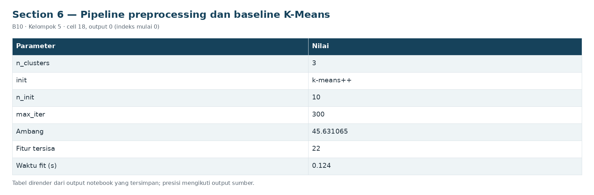
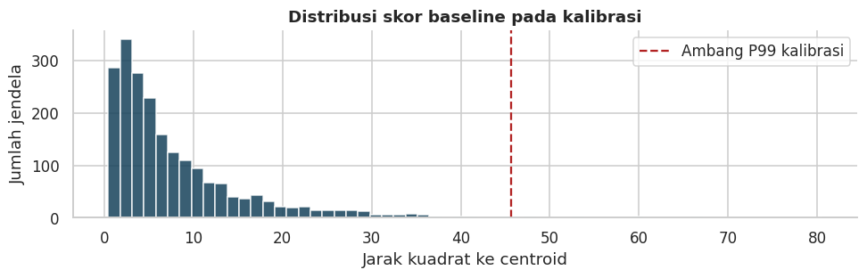

# Section 6 Pipeline preprocessing dan baseline K-Means

**SECTION 6: Pipeline preprocessing dan baseline K-Means**

Imputer median, filter konstan, StandardScaler dan estimator dipasang di dalam Pipeline; fit hanya pada train. Baseline K=3 tetap untuk perbandingan terkontrol.

[Galeri seluruh tahap](../GALLERY.md) · [Notebook sumber](../../notebooks/UTS_ML_B10_Kelompok5.ipynb)

[Tabel CSV dari output tersimpan](../../results/recorded/tables/s06_c018_o00.csv)

| Parameter | Nilai |
| --- | --- |
| n_clusters | 3 |
| init | k-means++ |
| n_init | 10 |
| max_iter | 300 |
| Ambang | 45.631065 |
| Fitur tersisa | 22 |
| Waktu fit (s) | 0.124 |

[Tabel CSV dari output tersimpan](../../results/recorded/tables/s06_c018_o02.csv)

| window_end | score | exceed | alarm |
| --- | --- | --- | --- |
| 2020-02-21 00:10:00 | 3.152869 | 0 | 0 |
| 2020-02-21 00:15:00 | 2.250899 | 0 | 0 |
| 2020-02-21 00:20:00 | 2.662928 | 0 | 0 |
| 2020-02-21 00:25:00 | 4.800659 | 0 | 0 |
| 2020-02-21 00:30:00 | 7.053292 | 0 | 0 |

[Tabel CSV dari output tersimpan](../../results/recorded/tables/s06_c018_o04.csv)

| feature | train_unique | validation_unique | validation_changed_from_train |
| --- | --- | --- | --- |
| Caudal_impulses__duty | 1 | 14 | True |
| LPS__duty | 1 | 35 | True |
| Oil_level__duty | 1 | 21 | True |

**Hasil baseline:** 22/25 fitur dipertahankan; ambang 45.631065; pelampauan kalibrasi 0.96%, alarm 0.00%. Sinyal konstan saat train tidak dapat dipelajari variasinya; jika berubah di validasi, perubahan tersebut dilaporkan sebagai blind spot, bukan disembunyikan atau dianggap tidak penting.
