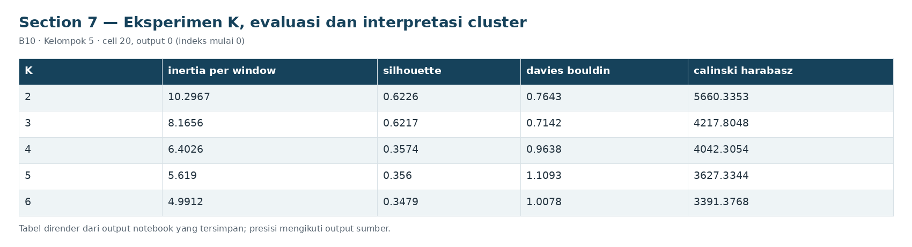
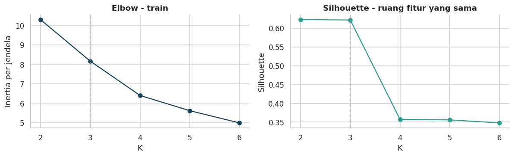

# Section 7 Eksperimen K, evaluasi dan interpretasi cluster

**SECTION 7: Eksperimen K, evaluasi dan interpretasi cluster**

K=2-6 dibandingkan pada ruang fitur train yang sama. K=3 tetap sebagai baseline; nilai silhouette terbaik bukan otomatis detektor gangguan terbaik.

[Galeri seluruh tahap](../GALLERY.md) · [Notebook sumber](../../notebooks/UTS_ML_B10_Kelompok5.ipynb)

[Tabel CSV dari output tersimpan](../../results/recorded/tables/s07_c020_o00.csv)

| K | inertia_per_window | silhouette | davies_bouldin | calinski_harabasz |
| --- | --- | --- | --- | --- |
| 2 | 10.2967 | 0.6226 | 0.7643 | 5660.3353 |
| 3 | 8.1656 | 0.6217 | 0.7142 | 4217.8048 |
| 4 | 6.4026 | 0.3574 | 0.9638 | 4042.3054 |
| 5 | 5.619 | 0.356 | 1.1093 | 3627.3344 |
| 6 | 4.9912 | 0.3479 | 1.0078 | 3391.3768 |

[Tabel CSV dari output tersimpan](../../results/recorded/tables/s07_c020_o02.csv)

| cluster | n_windows | proporsi | TP3__mean | Motor_current__mean | Oil_temperature__mean | pressure_gap_mean | motor_load_fraction |
| --- | --- | --- | --- | --- | --- | --- | --- |
| 0 | 4108 | 0.8246 | 8.93 | 0.7731 | 56.7366 | -0.0025 | 0.0012 |
| 1 | 795 | 0.1596 | 9.1025 | 3.3919 | 56.895 | -0.001 | 0.1685 |
| 2 | 79 | 0.0159 | 9.2894 | 3.7446 | 58.0592 | -0.001 | 0.1484 |

[Tabel CSV dari output tersimpan](../../results/recorded/tables/s07_c020_o03.csv)

| cluster | n_windows | proporsi | TP3__mean | Motor_current__mean | Oil_temperature__mean | pressure_gap_mean | motor_load_fraction | interpretasi_relatif |
| --- | --- | --- | --- | --- | --- | --- | --- | --- |
| 0 | 4108 | 0.824568 | 8.930034 | 0.773147 | 56.736573 | -0.002481 | 0.001246 | Arus mean 0.77 A; proporsi berbeban 0.1%; beba... |
| 1 | 795 | 0.159574 | 9.102508 | 3.391865 | 56.895041 | -0.000951 | 0.168512 | Arus mean 3.39 A; proporsi berbeban 16.9%; beb... |
| 2 | 79 | 0.015857 | 9.289447 | 3.744601 | 58.059219 | -0.000999 | 0.148373 | Arus mean 3.74 A; proporsi berbeban 14.8%; beb... |

**Hasil:** silhouette train terbaik pada K=2; baseline K=3 mempunyai cluster 0=4,108 jendela, cluster 1=795 jendela, cluster 2=79 jendela. Nama cluster bersifat arbitrer; interpretasi relatif didasarkan pada rerata sensor dan proporsi beban, tidak menyamakan cluster kecil dengan kerusakan. K tidak diubah berdasarkan benchmark uji.
