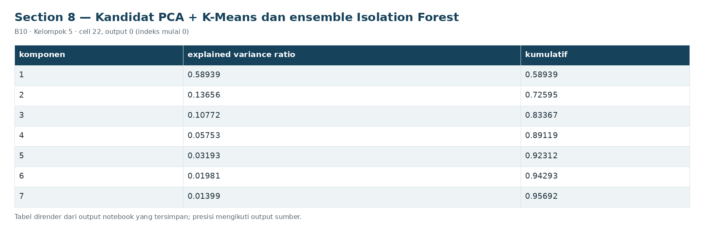
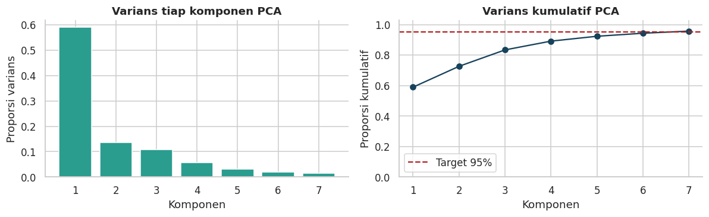

# Section 8 Kandidat PCA + K-Means dan ensemble Isolation Forest

**SECTION 8: Kandidat PCA + K-Means dan ensemble Isolation Forest**

PCA menguji kompresi korelasi dan Isolation Forest menguji pendekatan non-linear berbasis ensemble pohon. Data, kalibrasi, kuantil dan persistensi identik.

[Galeri seluruh tahap](../GALLERY.md) · [Notebook sumber](../../notebooks/UTS_ML_B10_Kelompok5.ipynb)

[Tabel CSV dari output tersimpan](../../results/recorded/tables/s08_c022_o00.csv)

| komponen | explained_variance_ratio | kumulatif |
| --- | --- | --- |
| 1 | 0.58939 | 0.58939 |
| 2 | 0.13656 | 0.72595 |
| 3 | 0.10772 | 0.83367 |
| 4 | 0.05753 | 0.89119 |
| 5 | 0.03193 | 0.92312 |
| 6 | 0.01981 | 0.94293 |
| 7 | 0.01399 | 0.95692 |

[Tabel CSV dari output tersimpan](../../results/recorded/tables/s08_c022_o01.csv)

| model | fit_windows | fitur_awal | setelah_filter | dimensi_model | threshold_P99 | fit_seconds |
| --- | --- | --- | --- | --- | --- | --- |
| KMeans | 4982 | 25 | 22 | 22 | 45.6311 | 0.1244 |
| PCA_KMeans | 4982 | 25 | 22 | 7 | 36.7491 | 0.1037 |
| IsolationForest | 4982 | 25 | 22 | 22 | 0.6592 | 0.5271 |

**Hasil:** PCA mempertahankan 7 komponen dari 22 fitur yang lolos filter, varians kumulatif 95.69%. Isolation Forest memakai 200 pohon dan max_samples=256. Varians PCA bukan metrik akurasi; arah varians kecil yang relevan terhadap anomali bisa hilang. contamination='auto' tidak dipakai sebagai ambang alarm; ambang tetap berasal dari skor kalibrasi.
