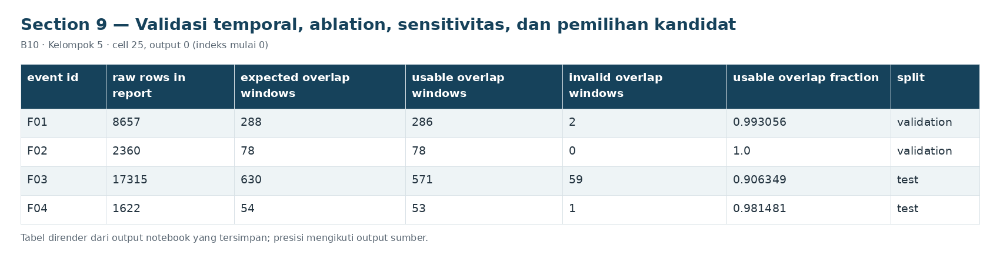
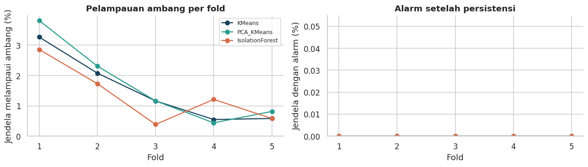
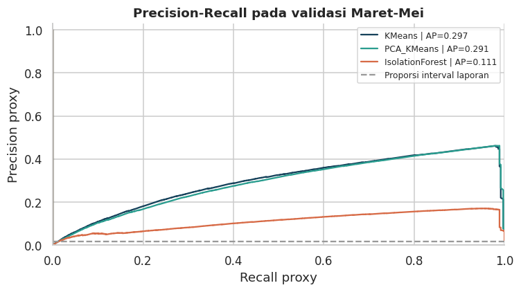
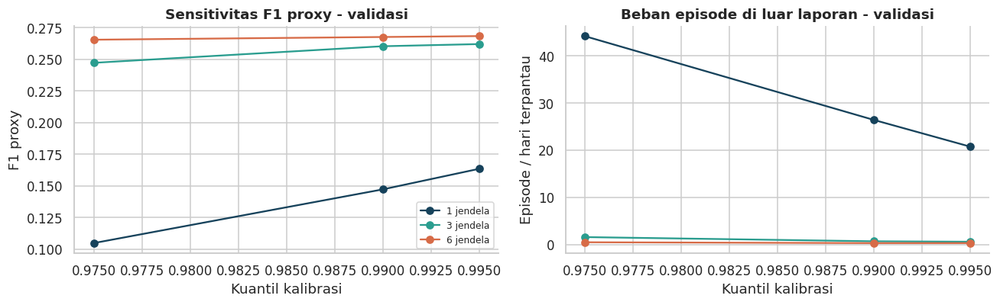

# Section 9 Validasi temporal, ablation, sensitivitas, dan pemilihan kandidat

**SECTION 9: Validasi temporal, ablation, sensitivitas, dan pemilihan kandidat**

Lima fold expanding window menguji respons terhadap waktu pada referensi; validasi Maret-Mei membandingkan kemampuan pemeringkatan dan alarm terhadap laporan.

[Galeri seluruh tahap](../GALLERY.md) · [Notebook sumber](../../notebooks/UTS_ML_B10_Kelompok5.ipynb)

[Tabel CSV dari output tersimpan](../../results/recorded/tables/s09_c025_o00.csv)

| event_id | raw_rows_in_report | expected_overlap_windows | usable_overlap_windows | invalid_overlap_windows | usable_overlap_fraction | split |
| --- | --- | --- | --- | --- | --- | --- |
| F01 | 8657 | 288 | 286 | 2 | 0.993056 | validation |
| F02 | 2360 | 78 | 78 | 0 | 1.0 | validation |
| F03 | 17315 | 630 | 571 | 59 | 0.906349 | test |
| F04 | 1622 | 54 | 53 | 1 | 0.981481 | test |

[Tabel CSV dari output tersimpan](../../results/recorded/tables/s09_c026_o01.csv)

| fold | model | n_train | n_calibration | n_validation | exceed_rate | alarm_rate | fit_seconds |
| --- | --- | --- | --- | --- | --- | --- | --- |
| 1 | KMeans | 656 | 192 | 734 | 0.0327 | 0.0 | 0.0314 |
| 1 | PCA_KMeans | 656 | 192 | 734 | 0.0381 | 0.0 | 0.0486 |
| 1 | IsolationForest | 656 | 192 | 734 | 0.0286 | 0.0 | 0.4864 |
| 2 | KMeans | 1311 | 272 | 865 | 0.0208 | 0.0 | 0.0391 |
| 2 | PCA_KMeans | 1311 | 272 | 865 | 0.0231 | 0.0 | 0.0904 |
| 2 | IsolationForest | 1311 | 272 | 865 | 0.0173 | 0.0 | 0.6523 |
| 3 | KMeans | 1962 | 485 | 772 | 0.0117 | 0.0 | 0.0717 |
| 3 | PCA_KMeans | 1962 | 485 | 772 | 0.0117 | 0.0 | 0.2826 |
| 3 | IsolationForest | 1962 | 485 | 772 | 0.0039 | 0.0 | 0.7151 |
| 4 | KMeans | 2595 | 624 | 906 | 0.0055 | 0.0 | 0.0825 |
| 4 | PCA_KMeans | 2595 | 624 | 906 | 0.0044 | 0.0 | 0.1285 |
| 4 | IsolationForest | 2595 | 624 | 906 | 0.0121 | 0.0 | 0.743 |
| 5 | KMeans | 3219 | 906 | 855 | 0.0058 | 0.0 | 0.1118 |
| 5 | PCA_KMeans | 3219 | 906 | 855 | 0.0082 | 0.0 | 0.1313 |

Cuplikan 14 dari 15 baris dan 8 dari 8 kolom tersimpan.

[Tabel CSV dari output tersimpan](../../results/recorded/tables/s09_c026_o02.csv)

| model | mean_exceed_rate | std_exceed_rate | mean_alarm_rate | std_alarm_rate | mean_fit_seconds | mean_relative_score | std_relative_score | mean_silhouette |
| --- | --- | --- | --- | --- | --- | --- | --- | --- |
| IsolationForest | 0.0136 | 0.0099 | 0.0 | 0.0 | 0.6289 | 0.6122 | 0.0258 | — |
| KMeans | 0.0153 | 0.0115 | 0.0 | 0.0 | 0.0673 | 0.1143 | 0.0151 | 0.5795 |
| PCA_KMeans | 0.0171 | 0.0137 | 0.0 | 0.0 | 0.1363 | 0.1112 | 0.0199 | 0.5958 |

Cuplikan 3 dari 3 baris dan 9 dari 10 kolom tersimpan.

**Kestabilan referensi:** 15 catatan model-fold. Rentang exceed rate 0.39%-3.81%; rentang alarm rate 0.00%-0.00%. Rerata dan simpangan baku ditampilkan pada tabel, namun lima fold saling berbagi data latih dan tidak merupakan lima sampel independen. Silhouette antarrepresentasi dipakai diagnostik masing-masing model, bukan bukti PCA lebih baik pada deteksi. Tidak ada recall kegagalan dari fold tanpa laporan.

[Tabel CSV dari output tersimpan](../../results/recorded/tables/s09_c028_o00.csv)

| model | n_windows | reported_windows | report_prevalence | AP_proxy | ROC_AUC_proxy | precision_proxy | recall_proxy | F1_proxy |
| --- | --- | --- | --- | --- | --- | --- | --- | --- |
| KMeans | 21286 | 364 | 0.0171 | 0.2974 | 0.9818 | 0.1499 | 0.9918 | 0.2604 |
| PCA_KMeans | 21286 | 364 | 0.0171 | 0.2907 | 0.9811 | 0.1491 | 0.9945 | 0.2593 |
| IsolationForest | 21286 | 364 | 0.0171 | 0.1105 | 0.9373 | 0.2481 | 0.9835 | 0.3962 |

Cuplikan 3 dari 3 baris dan 9 dari 30 kolom tersimpan.

[Tabel CSV dari output tersimpan](../../results/recorded/tables/s09_c028_o01.csv)

| model | n_windows | reported_windows | report_prevalence | AP_proxy | ROC_AUC_proxy | precision_proxy | recall_proxy | F1_proxy |
| --- | --- | --- | --- | --- | --- | --- | --- | --- |
| Kontrol_tanpa_alarm | 21286 | 364 | 0.0171 | 0.0171 | 0.5 | 0.0 | 0.0 | 0.0 |

Cuplikan 1 dari 1 baris dan 9 dari 28 kolom tersimpan.

[Tabel CSV dari output tersimpan](../../results/recorded/tables/s09_c028_o02.csv)

| bulan | model | reported_windows | AP_proxy | alarm_rate | F1_proxy |
| --- | --- | --- | --- | --- | --- |
| 2020-03 | KMeans | 0 | — | 0.0692 | 0.0 |
| 2020-04 | KMeans | 286 | 0.9248 | 0.1348 | 0.4826 |
| 2020-05 | KMeans | 78 | 0.1007 | 0.1401 | 0.1438 |
| 2020-03 | PCA_KMeans | 0 | — | 0.0711 | 0.0 |
| 2020-04 | PCA_KMeans | 286 | 0.9303 | 0.1352 | 0.4814 |
| 2020-05 | PCA_KMeans | 78 | 0.0976 | 0.1403 | 0.1454 |
| 2020-03 | IsolationForest | 0 | — | 0.0666 | 0.0 |
| 2020-04 | IsolationForest | 286 | 0.3124 | 0.0685 | 0.7605 |
| 2020-05 | IsolationForest | 78 | 0.0725 | 0.0684 | 0.2735 |

[Tabel CSV dari output tersimpan](../../results/recorded/tables/s09_c028_o04.csv)

| event_id | report_start | report_end | expected_overlap_windows | usable_overlap_windows | observed_report_windows | decision_windows_in_report | post_report_label_windows | coverage_fraction |
| --- | --- | --- | --- | --- | --- | --- | --- | --- |
| F01 | 2020-04-18 00:00:00 | 2020-04-18 23:59:00 | 288 | 286 | 286 | 285 | 1 | 0.993056 |
| F02 | 2020-05-29 23:30:00 | 2020-05-30 06:00:00 | 78 | 78 | 78 | 78 | 0 | 1.0 |
| F01 | 2020-04-18 00:00:00 | 2020-04-18 23:59:00 | 288 | 286 | 286 | 285 | 1 | 0.993056 |
| F02 | 2020-05-29 23:30:00 | 2020-05-30 06:00:00 | 78 | 78 | 78 | 78 | 0 | 1.0 |
| F01 | 2020-04-18 00:00:00 | 2020-04-18 23:59:00 | 288 | 286 | 286 | 285 | 1 | 0.993056 |
| F02 | 2020-05-29 23:30:00 | 2020-05-30 06:00:00 | 78 | 78 | 78 | 78 | 0 | 1.0 |

Cuplikan 6 dari 6 baris dan 9 dari 14 kolom tersimpan.

[Tabel CSV dari output tersimpan](../../results/recorded/tables/s09_c028_o05.csv)

| model | AP_proxy | F1_proxy | event_recall_report | outside_report_episodes_per_monitored_day | fit_seconds |
| --- | --- | --- | --- | --- | --- |
| KMeans | 0.29745 | 0.26037 | 1.0 | 0.6765 | 0.12437 |
| PCA_KMeans | 0.29072 | 0.25931 | 1.0 | 0.74415 | 0.10375 |
| IsolationForest | 0.11051 | 0.39624 | 1.0 | 0.43296 | 0.52715 |

**Pilihan validasi:** KMeans (AP 0.2974; F1 0.2604). F1 tertinggi: IsolationForest. AP adalah metrik pemeringkatan; pilihan prioritas tidak berarti unggul di semua metrik, dan deteksi seluruh interval tidak menyatakan semua jendela tepat. Perbandingan biaya fit dipengaruhi perangkat, sehingga bukan benchmark perangkat keras yang terkontrol.

[Tabel CSV dari output tersimpan](../../results/recorded/tables/s09_c030_o00.csv)

| model | n_features_input | AP_proxy | precision_proxy | recall_proxy | F1_proxy | outside_report_episodes_per_monitored_day |
| --- | --- | --- | --- | --- | --- | --- |
| KMeans_22_dasar | 22 | 0.29749 | 0.1509 | 0.99451 | 0.26203 | 0.63591 |
| KMeans_25_lengkap | 25 | 0.29745 | 0.14985 | 0.99176 | 0.26037 | 0.6765 |

**Temuan fitur:** perubahan AP validasi paket tiga fitur = -0.00004. Jika negatif, rekayasa fitur belum memberi manfaat pada kriteria tersebut dan tetap dilaporkan. Kesimpulan tidak boleh diubah menjadi 'fitur pasti meningkatkan akurasi'.

[Tabel CSV dari output tersimpan](../../results/recorded/tables/s09_c030_o02.csv)

| quantile | persistence | precision_proxy | recall_proxy | F1_proxy | event_recall_report | outside_report_episodes_per_monitored_day | is_primary_configuration |
| --- | --- | --- | --- | --- | --- | --- | --- |
| 0.975 | 1 | 0.05534 | 1.0 | 0.10488 | 1.0 | 44.2161 | False |
| 0.975 | 3 | 0.14119 | 0.99451 | 0.24727 | 1.0 | 1.56948 | False |
| 0.975 | 6 | 0.15355 | 0.98077 | 0.26553 | 1.0 | 0.47355 | False |
| 0.99 | 1 | 0.07952 | 0.99725 | 0.14729 | 1.0 | 26.43766 | False |
| 0.99 | 3 | 0.14985 | 0.99176 | 0.26037 | 1.0 | 0.6765 | True |
| 0.99 | 6 | 0.15505 | 0.97802 | 0.26767 | 1.0 | 0.29766 | False |
| 0.995 | 1 | 0.08908 | 0.99725 | 0.16355 | 1.0 | 20.76858 | False |
| 0.995 | 3 | 0.15098 | 0.99176 | 0.26207 | 1.0 | 0.58179 | False |
| 0.995 | 6 | 0.15553 | 0.97802 | 0.26838 | 1.0 | 0.29766 | False |

