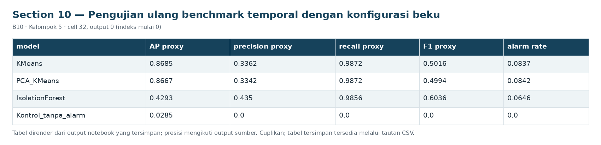
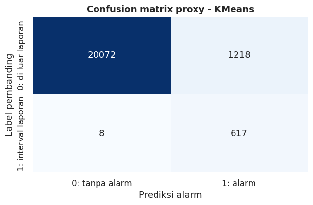
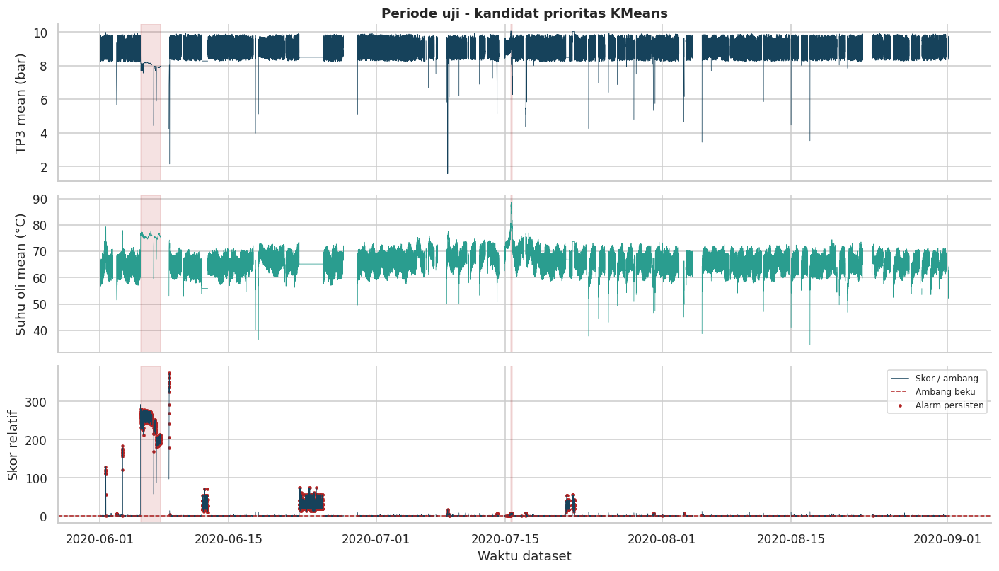

# Section 10 Pengujian ulang benchmark temporal dengan konfigurasi beku

**SECTION 10: Pengujian ulang benchmark temporal dengan konfigurasi beku**

Periode benchmark mengikuti versi lama. Hasil diuji ulang untuk konsistensi kode dan dilaporkan tanpa mengganti kandidat dari hasil benchmark.

[Galeri seluruh tahap](../GALLERY.md) · [Notebook sumber](../../notebooks/UTS_ML_B10_Kelompok5.ipynb)

[Tabel CSV dari output tersimpan](../../results/recorded/tables/s10_c032_o00.csv)

| model | n_windows | reported_windows | report_prevalence | AP_proxy | ROC_AUC_proxy | precision_proxy | recall_proxy | F1_proxy |
| --- | --- | --- | --- | --- | --- | --- | --- | --- |
| KMeans | 21915 | 625 | 0.0285 | 0.8685 | 0.9939 | 0.3362 | 0.9872 | 0.5016 |
| PCA_KMeans | 21915 | 625 | 0.0285 | 0.8667 | 0.9938 | 0.3342 | 0.9872 | 0.4994 |
| IsolationForest | 21915 | 625 | 0.0285 | 0.4293 | 0.9814 | 0.435 | 0.9856 | 0.6036 |
| Kontrol_tanpa_alarm | 21915 | 625 | 0.0285 | 0.0285 | 0.5 | 0.0 | 0.0 | 0.0 |

Cuplikan 4 dari 4 baris dan 9 dari 30 kolom tersimpan.

[Tabel CSV dari output tersimpan](../../results/recorded/tables/s10_c032_o01.csv)

| model | event_id | report_start | report_end | expected_overlap_windows | usable_overlap_windows | observed_report_windows | decision_windows_in_report | post_report_label_windows |
| --- | --- | --- | --- | --- | --- | --- | --- | --- |
| KMeans | F03 | 2020-06-05 10:00:00 | 2020-06-07 14:30:00 | 630 | 571 | 571 | 571 | 0 |
| KMeans | F04 | 2020-07-15 14:30:00 | 2020-07-15 19:00:00 | 54 | 53 | 54 | 53 | 1 |
| PCA_KMeans | F03 | 2020-06-05 10:00:00 | 2020-06-07 14:30:00 | 630 | 571 | 571 | 571 | 0 |
| PCA_KMeans | F04 | 2020-07-15 14:30:00 | 2020-07-15 19:00:00 | 54 | 53 | 54 | 53 | 1 |
| IsolationForest | F03 | 2020-06-05 10:00:00 | 2020-06-07 14:30:00 | 630 | 571 | 571 | 571 | 0 |
| IsolationForest | F04 | 2020-07-15 14:30:00 | 2020-07-15 19:00:00 | 54 | 53 | 54 | 53 | 1 |

Cuplikan 6 dari 6 baris dan 9 dari 14 kolom tersimpan.

**Hasil benchmark KMeans:** 21,915 jendela, AP proxy 0.8685, precision 0.3362, recall 0.9872, F1 0.5016; 2/2 kejadian teramati terdeteksi, 0 kejadian tidak teramati. Episode di luar laporan per hari terpantau 0.394. Seluruh angka berasal dari run ini; benchmark telah diperiksa pada versi lama, sehingga bukan validasi independen baru. Alarm di luar laporan memerlukan konfirmasi teknisi.
