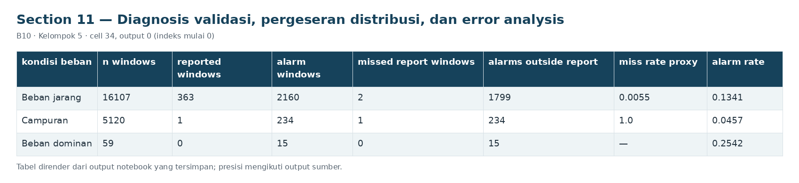

# Section 11 Diagnosis validasi, pergeseran distribusi, dan error analysis

**SECTION 11: Diagnosis validasi, pergeseran distribusi, dan error analysis**

Sampel yang gagal, kelompok beban, dan deviasi fitur pada validasi digunakan untuk merancang eksperimen setelah UTS, tanpa retuning benchmark.

[Galeri seluruh tahap](../GALLERY.md) · [Notebook sumber](../../notebooks/UTS_ML_B10_Kelompok5.ipynb)

[Tabel CSV dari output tersimpan](../../results/recorded/tables/s11_c034_o00.csv)

| kondisi_beban | n_windows | reported_windows | alarm_windows | missed_report_windows | alarms_outside_report | miss_rate_proxy | alarm_rate |
| --- | --- | --- | --- | --- | --- | --- | --- |
| Beban jarang | 16107 | 363 | 2160 | 2 | 1799 | 0.0055 | 0.1341 |
| Campuran | 5120 | 1 | 234 | 1 | 234 | 1.0 | 0.0457 |
| Beban dominan | 59 | 0 | 15 | 0 | 15 | — | 0.2542 |

[Tabel CSV dari output tersimpan](../../results/recorded/tables/s11_c034_o01.csv)

| event_id | report_start | report_end | expected_overlap_windows | usable_overlap_windows | observed_report_windows | decision_windows_in_report | post_report_label_windows | coverage_fraction |
| --- | --- | --- | --- | --- | --- | --- | --- | --- |
| F01 | 2020-04-18 00:00:00 | 2020-04-18 23:59:00 | 288 | 286 | 286 | 285 | 1 | 0.993056 |
| F02 | 2020-05-29 23:30:00 | 2020-05-30 06:00:00 | 78 | 78 | 78 | 78 | 0 | 1.0 |

Cuplikan 2 dari 2 baris dan 9 dari 13 kolom tersimpan.

[Tabel CSV dari output tersimpan](../../results/recorded/tables/s11_c034_o02.csv)

| start_alarm | last_alarm | n_windows | alarm_window_minutes | decision_span_minutes | overlaps_report | matching_reports |
| --- | --- | --- | --- | --- | --- | --- |
| 2020-03-02 16:45:00 | 2020-03-02 16:45:00 | 1 | 5.0 | 0.0 | False | — |
| 2020-03-02 17:25:00 | 2020-03-02 17:25:00 | 1 | 5.0 | 0.0 | False | — |
| 2020-03-04 16:30:00 | 2020-03-04 16:30:00 | 1 | 5.0 | 0.0 | False | — |
| 2020-03-05 04:25:00 | 2020-03-05 04:25:00 | 1 | 5.0 | 0.0 | False | — |
| 2020-03-05 07:40:00 | 2020-03-05 07:40:00 | 1 | 5.0 | 0.0 | False | — |
| 2020-03-05 10:00:00 | 2020-03-05 10:05:00 | 2 | 10.0 | 5.0 | False | — |
| 2020-03-06 09:05:00 | 2020-03-06 09:05:00 | 1 | 5.0 | 0.0 | False | — |
| 2020-03-06 18:45:00 | 2020-03-06 18:50:00 | 2 | 10.0 | 5.0 | False | — |
| 2020-03-06 21:55:00 | 2020-03-06 23:05:00 | 15 | 75.0 | 70.0 | False | — |
| 2020-03-09 06:25:00 | 2020-03-09 06:25:00 | 1 | 5.0 | 0.0 | False | — |

[Tabel CSV dari output tersimpan](../../results/recorded/tables/s11_c034_o03.csv)

| window_end | score | exceed | alarm | y_report | event_number | FN_proxy | outside_report_alarm | kondisi_beban |
| --- | --- | --- | --- | --- | --- | --- | --- | --- |
| 2020-03-02 16:45:00 | 69.677885 | 1 | 1 | 0 | 0 | False | True | Campuran |
| 2020-03-02 17:25:00 | 457.247854 | 1 | 1 | 0 | 0 | False | True | Campuran |
| 2020-03-04 16:30:00 | 79.081615 | 1 | 1 | 0 | 0 | False | True | Campuran |
| 2020-03-05 04:25:00 | 738.195989 | 1 | 1 | 0 | 0 | False | True | Beban dominan |
| 2020-03-05 07:40:00 | 207.863338 | 1 | 1 | 0 | 0 | False | True | Campuran |
| 2020-03-05 10:00:00 | 781.942441 | 1 | 1 | 0 | 0 | False | True | Campuran |
| 2020-03-05 10:05:00 | 372.668912 | 1 | 1 | 0 | 0 | False | True | Campuran |
| 2020-03-06 09:05:00 | 89.568699 | 1 | 1 | 0 | 0 | False | True | Campuran |

Cuplikan 8 dari 8 baris dan 9 dari 13 kolom tersimpan.

[Tabel CSV dari output tersimpan](../../results/recorded/tables/s11_c034_o04.csv)

| index | fitur | mean_abs_z_on_alarm | mean_abs_z_all_validation |
| --- | --- | --- | --- |
| 6 | DV_pressure__mean | 49.2004 | 6.4214 |
| 18 | Pressure_switch__duty | 15.8923 | 2.2768 |
| 17 | MPG__duty | 5.5395 | 1.5405 |
| 16 | Towers__duty | 5.3638 | 1.5115 |
| 15 | DV_eletric__duty | 5.1929 | 1.5008 |
| 14 | COMP__duty | 4.8927 | 1.4663 |
| 4 | H1__mean | 4.399 | 1.4007 |
| 0 | TP2__mean | 4.2933 | 1.3887 |
| 10 | Oil_temperature__mean | 4.1228 | 1.8838 |
| 12 | Motor_current__mean | 2.0382 | 1.116 |

[Tabel CSV dari output tersimpan](../../results/recorded/tables/s11_c034_o05.csv)

| feature | month | train_mean | validation_month_mean | standardized_mean_difference |
| --- | --- | --- | --- | --- |
| TP3__mean | 2020-03 | 8.9633 | 9.0441 | 0.1682 |
| TP3__mean | 2020-04 | 8.9633 | 9.0322 | 0.1435 |
| TP3__mean | 2020-05 | 8.9633 | 8.8923 | -0.1476 |
| Oil_temperature__mean | 2020-03 | 56.7828 | 62.1864 | 1.6209 |
| Oil_temperature__mean | 2020-04 | 56.7828 | 59.4607 | 0.8033 |
| Oil_temperature__mean | 2020-05 | 56.7828 | 62.2414 | 1.6374 |
| Motor_current__mean | 2020-03 | 1.2381 | 2.0769 | 0.5208 |
| Motor_current__mean | 2020-04 | 1.2381 | 1.8554 | 0.3832 |
| Motor_current__mean | 2020-05 | 1.2381 | 1.9839 | 0.463 |
| pressure_gap_mean | 2020-03 | -0.0022 | 0.0006 | 1.5528 |
| pressure_gap_mean | 2020-04 | -0.0022 | -0.0003 | 1.0324 |
| pressure_gap_mean | 2020-05 | -0.0022 | -0.0009 | 0.7032 |

**Error validasi:** 3 jendela laporan tanpa alarm dan 2,048 jendela alarm di luar laporan. Perbedaan mean terstandardisasi bersifat deskriptif; tidak otomatis membuktikan penyebab musiman atau kerusakan. Deviasi fitur pada alarm bukan feature importance kausal.
