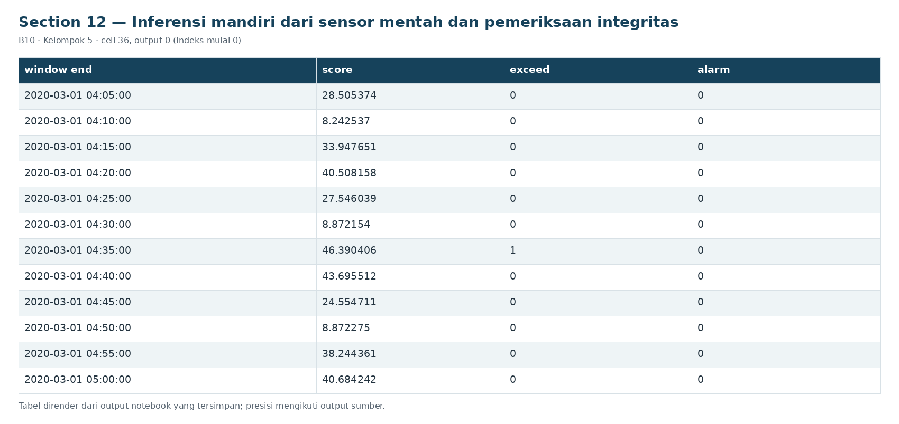

# Section 12 Inferensi mandiri dari sensor mentah dan pemeriksaan integritas

**SECTION 12: Inferensi mandiri dari sensor mentah dan pemeriksaan integritas**

Artefak menyimpan kolom, pipeline, ambang dan aturan fitur; fungsi inferensi tidak membaca label atau melakukan fit ulang. State menjaga persistensi antarpotongan data.

[Galeri seluruh tahap](../GALLERY.md) · [Notebook sumber](../../notebooks/UTS_ML_B10_Kelompok5.ipynb)

[Tabel CSV dari output tersimpan](../../results/recorded/tables/s12_c036_o00.csv)

| window_end | score | exceed | alarm |
| --- | --- | --- | --- |
| 2020-03-01 04:05:00 | 28.505374 | 0 | 0 |
| 2020-03-01 04:10:00 | 8.242537 | 0 | 0 |
| 2020-03-01 04:15:00 | 33.947651 | 0 | 0 |
| 2020-03-01 04:20:00 | 40.508158 | 0 | 0 |
| 2020-03-01 04:25:00 | 27.546039 | 0 | 0 |
| 2020-03-01 04:30:00 | 8.872154 | 0 | 0 |
| 2020-03-01 04:35:00 | 46.390406 | 1 | 0 |
| 2020-03-01 04:40:00 | 43.695512 | 0 | 0 |
| 2020-03-01 04:45:00 | 24.554711 | 0 | 0 |
| 2020-03-01 04:50:00 | 8.872275 | 0 | 0 |
| 2020-03-01 04:55:00 | 38.244361 | 0 | 0 |
| 2020-03-01 05:00:00 | 40.684242 | 0 | 0 |

[Tabel CSV dari output tersimpan](../../results/recorded/tables/s12_c036_o01.csv)

| pemeriksaan | lulus |
| --- | --- |
| Raw sensor -> fitur -> skor sama dengan matrik... | True |
| Serialisasi joblib mempertahankan skor dan alarm | True |
| State antarbatch sama dengan batch penuh pada ... | True |
| Jeda waktu mereset persistensi | True |
| Fitur jendela selesai tidak berubah oleh tamba... | True |
| Modul file mandiri bekerja tanpa global notebook | True |

**Hasil inferensi nyata:** 12 jendela; 1 pelampauan dan 0 alarm. Flag buatan hanya dipakai untuk memeriksa logika batas dan tidak masuk metrik eksperimen. Setiap batch raw harus mencakup jendela lengkap tanpa memecah satu jendela di tengah. Untuk streaming, teruskan state dan observed_until; buffer sampel sampai jendela selesai.
