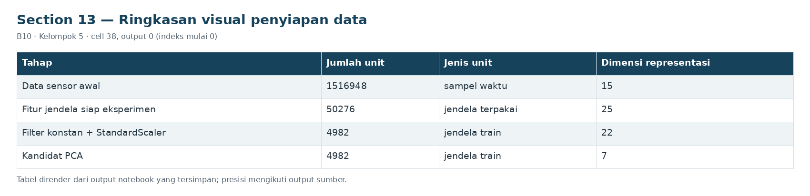
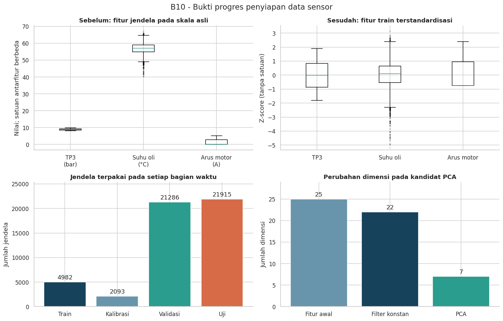

# Section 13 Ringkasan visual penyiapan data

**SECTION 13: Ringkasan visual penyiapan data**

Bandingkan skala sebelum/sesudah pada jendela train yang sama dan tampilkan perubahan unit analisis serta dimensi.

[Galeri seluruh tahap](../GALLERY.md) · [Notebook sumber](../../notebooks/UTS_ML_B10_Kelompok5.ipynb)

[Tabel CSV dari output tersimpan](../../results/recorded/tables/s13_c038_o00.csv)

| Tahap | Jumlah unit | Jenis unit | Dimensi representasi |
| --- | --- | --- | --- |
| Data sensor awal | 1516948 | sampel waktu | 15 |
| Fitur jendela siap eksperimen | 50276 | jendela terpakai | 25 |
| Filter konstan + StandardScaler | 4982 | jendela train | 22 |
| Kandidat PCA | 4982 | jendela train | 7 |

**Ringkasan:** 1,516,948 sampel mentah menjadi 50,276 jendela terpakai; 25 fitur awal -> 22 fitur nonkonstan -> 7 komponen PCA. Perubahan jumlah baris menjadi jendela adalah perubahan unit analisis, bukan seluruhnya data yang dibuang. Eksklusi kualitas dan embargo dihitung terpisah pada ringkasan jendela.
