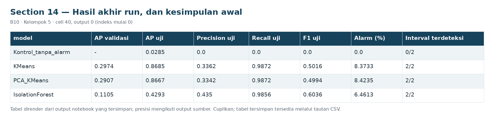
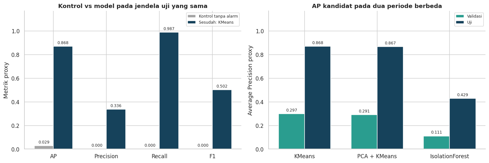
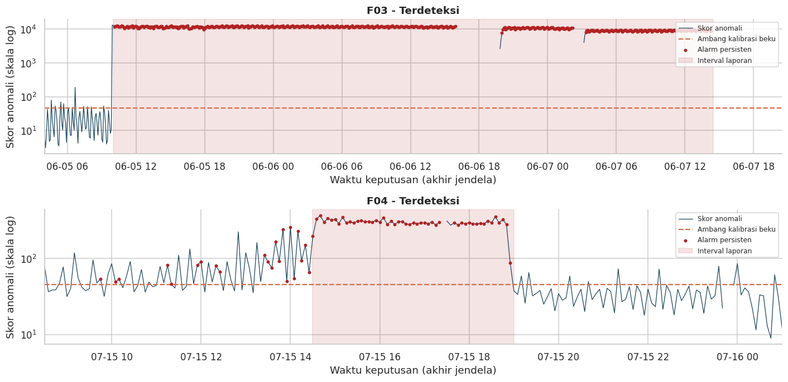

# Section 14 Hasil akhir run, dan kesimpulan awal

**SECTION 14: Hasil akhir run, dan kesimpulan awal**

Ringkasan mengambil angka hasil, mempertahankan perbedaan AP dan F1, serta menyatakan pekerjaan lanjutan beserta bukti penerimaannya.

[Galeri seluruh tahap](../GALLERY.md) · [Notebook sumber](../../notebooks/UTS_ML_B10_Kelompok5.ipynb)

[Tabel CSV dari output tersimpan](../../results/recorded/tables/s14_c040_o00.csv)

| model | AP validasi | AP uji | Precision uji | Recall uji | F1 uji | Alarm (%) | Interval terdeteksi | Pilihan validasi |
| --- | --- | --- | --- | --- | --- | --- | --- | --- |
| Kontrol_tanpa_alarm | - | 0.0285 | 0.0 | 0.0 | 0.0 | 0.0 | 0/2 | - |
| KMeans | 0.2974 | 0.8685 | 0.3362 | 0.9872 | 0.5016 | 8.3733 | 2/2 | Ya |
| PCA_KMeans | 0.2907 | 0.8667 | 0.3342 | 0.9872 | 0.4994 | 8.4235 | 2/2 | - |
| IsolationForest | 0.1105 | 0.4293 | 0.435 | 0.9856 | 0.6036 | 6.4613 | 2/2 | - |

[Tabel CSV dari output tersimpan](../../results/recorded/tables/s14_c040_o03.csv)

| Interval | Awal laporan | Akhir laporan | Terdeteksi saat laporan | Alarm pertama dalam laporan | Jeda dari awal laporan (menit) |
| --- | --- | --- | --- | --- | --- |
| F03 | 2020-06-05 10:00:00 | 2020-06-07 14:30:00 | True | 2020-06-05 10:05:00 | 5.0 |
| F04 | 2020-07-15 14:30:00 | 2020-07-15 19:00:00 | True | 2020-07-15 14:35:00 | 5.0 |

[Tabel CSV dari output tersimpan](../../results/recorded/tables/s14_c040_o04.csv)

| Tujuan / batas penggunaan | Status | Bukti hasil |
| --- | --- | --- |
| Menghasilkan skor dan alarm | Tercapai | 21,915 jendela uji; proporsi alarm 8.37% |
| Membandingkan kandidat | Tercapai | 3 kandidat; pilihan dari AP validasi: KMeans |
| Kesesuaian dengan interval gangguan | Didukung pada seluruh interval uji | 2/2 interval terdeteksi; 8 jendela laporan tan... |
| Menilai ketepatan alarm | Masih memerlukan verifikasi | Precision proxy 0.3362; 1,218 alarm di luar la... |
| Membuktikan kelayakan operasional | Belum dapat disimpulkan | Label laporan lemah dan kejadian terbatas pada... |

**Kesimpulan run:** KMeans dipilih dari AP validasi 0.2974; benchmark menghasilkan AP 0.8685, precision 0.3362, recall 0.9872, F1 0.5016. Deteksi 2/2 kejadian teramati, 8 jendela laporan tanpa alarm, dan 1,218 alarm jendela di luar laporan. F1 validasi terbaik berasal dari IsolationForest; pilihan AP tidak menyatakan dominasi seluruh metrik. Alur deteksi dan pembandingan classical ML tersedia, namun diagnosis penyebab, peringatan dini, kelayakan industri, dan generalisasi lintas mesin belum terbukti.
